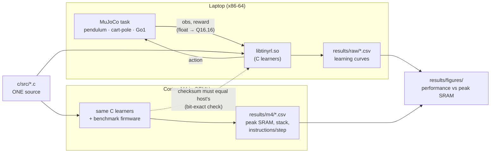

# Gait-adaptive robot: learning that fits in a microcontroller

A simulated quadruped (Unitree Go1, MuJoCo) adapts its trot to rough ground
with reinforcement learners small enough to run, **and learn**, inside a
Cortex-M4's 128 KB of SRAM. Three learners written in fixed-point C — a table, a
linear model on hashed tile codings and a tiny neural network — are compared on
the same learning target: learning performance, adaptation speed and compute
cost against peak working memory.

**Research question.** How do different reinforcement-learning representations
trade learning performance, adaptation speed and compute cost against peak
working memory when learning online on a Cortex-M4-class platform?

> **Status: reference implementation, every stage built and smoke-tested; first
> experiments (Stage 2, pendulum first pass) recorded in [`docs/results.md`](docs/results.md).** Numbers seen while building are in
> [`docs/build_notes.md`](docs/build_notes.md), from single seeds. They are
> not results. A number enters [`docs/results.md`](docs/results.md) only after a
> full run with ≥ 5 seeds, from a recorded commit and command. Hardware
> timing or power claims need the real STM32F446RE.

## What changed after the literature review (17 Nov 2026)

[`docs/research_review.md`](docs/research_review.md) surveys recent work. These are in the code now, all opt-in, with defaults reproducing the original behaviour:

| Area | Change | Measured so far |
|---|---|---|
| Tiny network | Stream Q(λ): ObGD step cap, eligibility traces, LayerNorm, no replay, no target net (`lam`, `obgd_kappa`, `norm`) | 16 hidden: **1.8 KB** peak SRAM vs 16.8 KB with a 500-transition buffer (QEMU M4) |
| All learners | λ and ObGD available to table and linear too, so the comparison stays about representation | sparse traces: 64 (table) / 8·T (linear) entries |
| Fixed point | stochastic rounding (`round_mode: 1`) and an underflow counter in every run | a sub-LSB update test: nearest rounding keeps 0%, stochastic 99.8% of the exact value |
| Tile coding | cached features, precomputed offsets, 32-bit maths, mask for 2^k features: same outputs | **8,415 → 1,604** instructions/step on the M4 |
| Table | 32-bit division when it fits: same outputs | ~830 → ~530 instructions/step |
| Evaluation | step budget, 10 paired seeds, equal-budget tuning (`scripts/tune.py`), seed dots, paired differences, new adaptation metric, from-scratch reference | — |
| Go1 | phase-locked decisions + pair bit + half-cycle IMU averaging (`go1_gait_v2`); terrain difficulty sweep (`scripts/go1_difficulty.py`) | open-loop success: 1.0 at roughness 0.05, 0.4–0.5 at 0.08–0.09 (10 episodes each: a lead) |

## Second review (17 Nov evening): algorithm trade-offs and self-adapting gaits

[`docs/research_review_2.md`](docs/research_review_2.md). Main message: on this chip compute is nearly free at 4–50 Hz;
SRAM and real samples are scarce, so spend cycles to save samples without spending SRAM.

| Added | Measured so far |
|---|---|
| Compressed replay (`replay_compact`), replay-ratio experiment (Stage 4 redefined) | buffer 2.67× smaller; M4 network 16.4 → 6.9 KB |
| Dense tiles (`tile_dense: 1`), hash finaliser (`tile_dense: 2`), `scripts/tile_collisions.py` | default pendulum hashing shares 64% of slots; with finaliser 51% |
| Continual backprop for the network, Q2.30 ObGD step | — |
| Kernel trade-off map: Q16.16 vs float32 vs q15, LSTD-Q, Dyna-Q (`scripts/bench_kernels.py`) | float32 ≈ Q16.16 for table and tiles; network 14–20% fewer instructions in float (QEMU understates float cost); LSTD-Q k=64: 135k instr., 18 KB |
| Go1 self-adapting gait: Tegotae phase feedback, IMU posture reflex, stumble reflex (B1–B4), ES over gains (B5), contacts, factored and persistent actions, `go1_gait_v3` | stumble reflex: success 0.1 → 0.7 at roughness 0.10 (10 episodes: a lead) |

## Learning on the chip: processor-in-the-loop (17 Nov, round 3)

The learner can run **on the microcontroller** while the laptop only simulates the robot:

```
 laptop: MuJoCo task + harness  ──UART frames: obs, reward──▶  Cortex-M4: tr_act / tr_observe in SRAM
                                ◀──── action, cycle count ────
```

Add `"pil": "tcp:HOST:PORT"` (QEMU) or `"pil": "serial:/dev/ttyACM0"` (Nucleo-F446RE) to any learner config.
`python3 scripts/pil_check.py` starts the firmware in QEMU and checks that on-chip learning reproduces the host
learning curve **bit for bit** (passes for table, linear, compressed-replay network and streaming network; also in CI).
On a Nucleo it records cycles per `act()` / `observe()`: the first timing numbers the project may claim.
The Nucleo build (`make -C m4/pil nucleo`) has **not been run on hardware yet**.

## How it fits together



The same C files are compiled twice. On the laptop they learn inside MuJoCo
tasks, which gives the learning curves. For the M4 they run in QEMU, which
gives memory and instruction counts. A checksum check proves both builds
take identical actions, so the curves describe the code that runs on the chip.

## Quick start (Ubuntu 24.04)

```bash
bash scripts/setup_ubuntu.sh          # once: apt packages, .venv, build, all tests
source .venv/bin/activate              # every new terminal

make test                              # C unit tests + Python tests (incl. Stage 1 gate)
python3 scripts/run_sweep.py smoke     # ~1 min pipeline check
python3 scripts/measure_m4.py smoke    # build + run each config on the M4 in QEMU
python3 scripts/make_plots.py smoke    # figures in results/figures/
python3 scripts/view_go1.py            # watch the robot (needs a display)
```

## Stages

| # | Stage | Command(s) | Gate (from the project brief) |
|---|-------|------------|------|
| 1 | Corridor, Q-learning by hand → Python → C | `python3 -m tinyrl.ref.corridor_ref` (in `python/`), `make test` | C matches Python bit for bit ✅ (test passes) |
| 2 | Pendulum, table learner | `run_sweep.py stage2_pendulum_table`, `measure_m4.py …`, `make_plots.py …` | if the emulator costs > 6 h, measure RAM from the binary and move on |
| 3 | Linear + network learners (incl. streaming network) | `… pendulum_main`, `… stream_ablation` | if the network will not learn stably, report it and continue with two |
| 4 | Replay ratio (compressed buffer) | `… replay_ratio`, `… stage4_buffer` | kill criterion in `replay_ratio.json` |
| 5 | Cart-pole + sweeps | `… cartpole_main`, `… adaptation_pendulum` (+ `_scratch`) | no plot → cut the sweep until one exists |
| 6 | Write-up | `docs/results.md` | — |
| 7 | Gait adaptation on Go1 | `scripts/go1_difficulty.py --ladder`, `scripts/go1_es.py`, `… go1_gait_v3`, `scripts/view_go1.py` | — |

Step-by-step instructions, what to read in the code at each stage and how to
rewrite each learner yourself: [`docs/stages.md`](docs/stages.md).

## Repository map

```
c/include/      tr_fixed.h (Q16.16 maths), tr_rng.h (xorshift32), tinyrl.h (learner API)
c/src/          tr_agent.c (shared: target, ε-greedy, replay, streaming Q(λ)+ObGD), tr_tabular.c, tr_linear.c, tr_mlp.c, tr_trace.c
c/envs/         corridor.h (Stage 1 toy task in C)
c/tests/        unit tests, corridor trace program, host build of the M4 benchmark
m4/             Cortex-M4 firmware: startup, linker script (F446 memory map), semihosting, benchmark
tools/qemu_plugin/  QEMU plugin that counts executed instructions
python/tinyrl/  cbind.py (ctypes → C), envs/ (MuJoCo tasks), harness.py, sweep.py, analysis.py, plots.py
python/tinyrl/ref/  Python references: bit-exact corridor mirror, float twins of the learners
configs/        one JSON per experiment
scripts/        run_experiment.sh (tune + sweep + M4 + plots), run_sweep.py, tune.py, measure_m4.py, make_plots.py,
                pil_check.py, bench_kernels.py, tile_collisions.py, go1_difficulty.py, go1_es.py, view_go1.py, setup_ubuntu.sh
m4/kernels/     candidate update kernels for the trade-off map
m4/pil/         processor-in-the-loop firmware: QEMU and Nucleo-F446RE builds (board.h)
assets/unitree_go1/  Go1 model from MuJoCo Menagerie (BSD-3, see its LICENSE) + our rough-terrain scene
docs/           architecture, decisions log (with the 17 Nov decision review), stages guide, research reviews
                + raw research notes, results log, build notes
```

## Ground rules

- No result without a measurement behind it, and no hardware, timing or power claims from QEMU.
  QEMU counts instructions, not cycles, and it is not the STM32F446RE.
- Novelty wording: "a controlled comparison was not found in a limited search". Never "first".
- Every design choice made while building is in [`docs/decisions.md`](docs/decisions.md),
  marked **to review**. Accept, change or reject each one, and log why.

## Credits

Go1 model: [MuJoCo Menagerie](https://github.com/google-deepmind/mujoco_menagerie), BSD-3-Clause, © Unitree Robotics.
Physics: [MuJoCo](https://mujoco.org). Tile coding follows Sutton & Barto (2018), §9.5.4.
