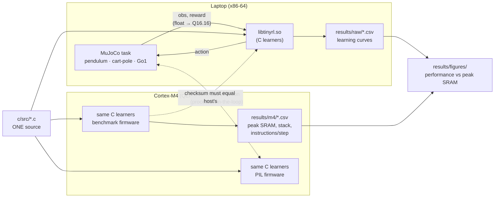

# Gait-adaptive robot: learning that fits in a microcontroller

A simulated quadruped (Unitree Go1, MuJoCo) adapts its trot to rough ground with reinforcement learners small
enough to run, **and learn**, inside a Cortex-M4's 128 KB of SRAM. Three learners written in fixed-point C — a
table, a linear model on hashed tile codings and a tiny neural network — share one learning target and are
compared on learning performance, adaptation speed and compute cost against peak working memory.

**Research question.** How do different reinforcement-learning representations trade learning performance,
adaptation speed and compute cost against peak working memory when learning online on a Cortex-M4-class platform?

> **Status (17 Nov 2026):** every stage built and tested (CI: C tests, Python tests, host == M4 bit-exact,
> learning on the emulated chip). First measured results in [`docs/results.md`](docs/results.md). Not yet:
> the 10-seed rerun of the main comparison, cart-pole / adaptation / Go1 experiments, any real-hardware timing.


*First pass (5 seeds) of the main comparison on the pendulum: final performance against peak SRAM measured on
the M4, one panel per input encoding. Rerun with 10 seeds before citing.*

## Results so far

| What | Finding | Strength |
|---|---|---|
| Stage 1 gate | C learner reproduces the Python Q16.16 reference bit for bit | deterministic test |
| Stage 2, table | final return rises monotonically with memory: −948 ± 47 at 1.0 KB → −245 ± 70 at 12.2 KB; ~530 instructions/step | 10 seeds |
| Main comparison | streaming network best per byte (2.8 KB: −179 ± 41) but 30–60× the table's instructions; tile coding best overall (13 KB: −142 ± 13) | 5 seeds, first pass |
| On-chip learning | learning on the emulated M4 reproduces host learning bit for bit (4 learner types) | deterministic test |

Full table with commits and commands: [`docs/results.md`](docs/results.md). Single-seed observations from the
build are in [`docs/build_notes.md`](docs/build_notes.md) and are not results.

## What is in it

| Part | Contents |
|---|---|
| Learners (`c/`) | table, hashed tile coding (FNV + finaliser, or dense), tiny ReLU network; one shared Q-learning target; optional replay (plain or compressed), target network, TD clipping, Watkins Q(λ) + ObGD step cap for all three (streaming), LayerNorm, continual backprop, stochastic rounding; underflow counter |
| Tasks (`python/tinyrl/envs/`) | corridor (Stage 1), pendulum, cart-pole, Unitree Go1 trot on rough ground with a CPG, phase lock, foot contacts, reflexes (Tegotae, posture, stumble) and three action modes |
| Protocol | step budgets, 10 paired seeds, equal-budget tuning on separate seeds, baselines in every experiment, paired differences, adaptation metric with a from-scratch reference |
| Measurement | every configuration built for the Cortex-M4 and run in QEMU: peak SRAM (agent + arena + stack), instructions per step, host == M4 checksum; kernel trade-off map (Q16.16 / float32 / q15, LSTD-Q, Dyna-Q) |
| On-chip learning | processor-in-the-loop over UART: QEMU (verified) and Nucleo-F446RE (written, not yet run on hardware) |
| Docs | stages guide, architecture, decisions log with a decision review, two literature reviews + raw notes, results log, build notes, changelog |

## How it fits together



The same C files are compiled three times: for the laptop (learning curves in MuJoCo), for benchmark firmware
(memory and instruction counts in QEMU) and for processor-in-the-loop firmware (the learner learns on the chip
while the laptop only simulates the robot). Checksums and the PIL check prove all three behave identically.

## Quick start (Ubuntu 24.04)

```bash
bash scripts/setup_ubuntu.sh                    # once: apt packages, .venv, build, all tests
source .venv/bin/activate                        # every new terminal

make test                                        # C unit tests + Python tests (incl. Stage 1 gate)
python3 scripts/pil_check.py                     # learning on the emulated chip == laptop
bash scripts/run_experiment.sh stage2_pendulum_table   # tune + sweep + M4 measurement + plots
python3 scripts/results_table.py stage2_pendulum_table_tuned   # table for docs/results.md
python3 scripts/view_go1.py                      # watch the robot (needs a display)
```

## Stages

| # | Stage | Command | Gate (from the project brief) |
|---|-------|---------|------|
| 1 | Corridor, Q-learning by hand → Python → C | `python3 -m tinyrl.ref.corridor_ref` (in `python/`), `make test` | C matches Python bit for bit ✅ |
| 2 | Pendulum, table learner | `run_experiment.sh stage2_pendulum_table` | if the emulator costs > 6 h, measure RAM from the binary |
| 3 | Linear + network learners | `run_experiment.sh pendulum_main`, `… stream_ablation`, `… tile_collisions` | if the network will not learn stably, report it and continue with two |
| 4 | Replay ratio (compressed buffer) | `run_sweep.py replay_ratio --only table` | stopped at the gate, 22 Nov (D53): not met |
| 5 | Cart-pole + adaptation | `… cartpole_main`, `… adaptation_pendulum` (+ `_scratch`) | no plot → cut the sweep until one exists |
| 6 | Write-up | `docs/results.md` | — |
| 7 | Gait adaptation on Go1 | `scripts/go1_difficulty.py --ladder`, `scripts/go1_es.py`, `… go1_gait_v3` | — |

What to read, what to rewrite yourself and what each gate means: [`docs/stages.md`](docs/stages.md).

## Repository map

```
c/include/          tr_fixed.h (Q16.16 maths), tr_rng.h (xorshift32), tinyrl.h (learner API)
c/src/              tr_agent.c (shared target, ε-greedy, replay, streaming Q(λ)+ObGD), tr_tabular.c,
                    tr_linear.c, tr_mlp.c, tr_trace.c
c/envs/, c/tests/   corridor in C; unit tests, corridor trace, host build of the M4 benchmark
m4/                 Cortex-M4 benchmark firmware: startup, linker script (F446 memory map), semihosting
m4/kernels/         candidate update kernels for the trade-off map
m4/pil/             processor-in-the-loop firmware (QEMU and Nucleo-F446RE builds)
tools/qemu_plugin/  QEMU plugin that counts executed instructions
python/tinyrl/      cbind.py (ctypes → C), pil.py, envs/, harness.py, sweep.py, analysis.py, plots.py
python/tinyrl/ref/  Python references: bit-exact corridor mirror, float twins of the learners
configs/            one JSON per experiment (*_tuned.json are written by tune.py)
scripts/            run_experiment.sh, run_sweep.py, tune.py, measure_m4.py, make_plots.py, results_table.py,
                    pil_check.py, bench_kernels.py, tile_collisions.py, go1_difficulty.py, go1_es.py,
                    view_go1.py, setup_ubuntu.sh
results/            figures, M4 measurements and raw-log archives of reported experiments
docs/               stages, architecture, decisions, results, research reviews + notes, build notes, changelog
```

## Ground rules

- No result without a measurement behind it, and no hardware, timing or power claims from QEMU. QEMU counts
  instructions, not cycles, and it is not the STM32F446RE.
- A number enters `docs/results.md` only with its seeds, commit and command; raw logs go to `results/raw_archive/`.
- Novelty wording: "a controlled comparison was not found in a limited search". Never "first".
- Design choices live in [`docs/decisions.md`](docs/decisions.md). Change one by adding a new entry, never by editing history.

## Credits

Go1 model: [MuJoCo Menagerie](https://github.com/google-deepmind/mujoco_menagerie), BSD-3-Clause, © Unitree Robotics.
Physics: [MuJoCo](https://mujoco.org). Tile coding follows Sutton & Barto (2018), §9.5.4.
