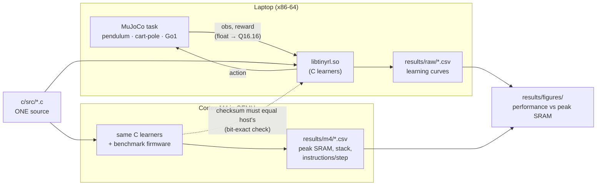

# Gait-adaptive robot: learning that fits in a microcontroller

A simulated quadruped (Unitree Go1, MuJoCo) adapts its trot to rough ground
with reinforcement learners small enough to run, **and learn**, inside a
Cortex-M4's 128 KB of SRAM. Three learners written in fixed-point C — a table, a
linear model on hashed tile codings and a tiny neural network — are compared on
the same learning target: learning performance, adaptation speed and compute
cost against peak working memory.

**Research question.** How do different reinforcement-learning representations
trade learning performance, adaptation speed and compute cost against peak
working memory when learning online on a Cortex-M4-class platform?

> **Status: reference implementation, every stage built and smoke-tested.
> No results yet.** Numbers seen while building are in
> [`docs/build_notes.md`](docs/build_notes.md), from single seeds. They are
> not results. A number enters [`docs/results.md`](docs/results.md) only after a
> full run with ≥ 5 seeds, from a recorded commit and command. Hardware
> timing or power claims need the real STM32F446RE.

## How it fits together



The same C files are compiled twice. On the laptop they learn inside MuJoCo
tasks, which gives the learning curves. For the M4 they run in QEMU, which
gives memory and instruction counts. A checksum check proves both builds
take identical actions, so the curves describe the code that runs on the chip.

## Quick start (Ubuntu 24.04)

```bash
bash scripts/setup_ubuntu.sh          # once: apt packages, .venv, build, all tests
source .venv/bin/activate              # every new terminal

make test                              # C unit tests + Python tests (incl. Stage 1 gate)
python3 scripts/run_sweep.py smoke     # ~1 min pipeline check
python3 scripts/measure_m4.py smoke    # build + run each config on the M4 in QEMU
python3 scripts/make_plots.py smoke    # figures in results/figures/
python3 scripts/view_go1.py            # watch the robot (needs a display)
```

## Stages

| # | Stage | Command(s) | Gate (from the project brief) |
|---|-------|------------|------|
| 1 | Corridor, Q-learning by hand → Python → C | `python3 -m tinyrl.ref.corridor_ref` (in `python/`), `make test` | C matches Python bit for bit ✅ (test passes) |
| 2 | Pendulum, table learner | `run_sweep.py stage2_pendulum_table`, `measure_m4.py …`, `make_plots.py …` | if the emulator costs > 6 h, measure RAM from the binary and move on |
| 3 | Linear + network learners | `… pendulum_main` | if the network will not learn stably, report it and continue with two |
| 4 | Replay buffer | `… stage4_buffer` | — |
| 5 | Cart-pole + sweeps | `… cartpole_main`, `… state_dim_pendulum`, `… adaptation_pendulum` | no plot → cut the sweep until one exists |
| 6 | Write-up | `docs/results.md` | — |
| 7 | Gait adaptation on Go1 | `… go1_gait`, `scripts/view_go1.py` | — |

Step-by-step instructions, what to read in the code at each stage and how to
rewrite each learner yourself: [`docs/stages.md`](docs/stages.md).

## Repository map

```
c/include/      tr_fixed.h (Q16.16 maths), tr_rng.h (xorshift32), tinyrl.h (learner API)
c/src/          tr_agent.c (shared: target, ε-greedy, replay), tr_tabular.c, tr_linear.c, tr_mlp.c
c/envs/         corridor.h (Stage 1 toy task in C)
c/tests/        unit tests, corridor trace program, host build of the M4 benchmark
m4/             Cortex-M4 firmware: startup, linker script (F446 memory map), semihosting, benchmark
tools/qemu_plugin/  QEMU plugin that counts executed instructions
python/tinyrl/  cbind.py (ctypes → C), envs/ (MuJoCo tasks), harness.py, sweep.py, analysis.py, plots.py
python/tinyrl/ref/  Python references: bit-exact corridor mirror, float twins of the learners
configs/        one JSON per experiment
scripts/        run_sweep.py, measure_m4.py, make_plots.py, view_go1.py, setup_ubuntu.sh
assets/unitree_go1/  Go1 model from MuJoCo Menagerie (BSD-3, see its LICENSE) + our rough-terrain scene
docs/           architecture, decisions log, stages guide, results log, build notes
```

## Ground rules

- No result without a measurement behind it, and no hardware, timing or power claims from QEMU.
  QEMU counts instructions, not cycles, and it is not the STM32F446RE.
- Novelty wording: "a controlled comparison was not found in a limited search". Never "first".
- Every design choice made while building is in [`docs/decisions.md`](docs/decisions.md),
  marked **to review**. Accept, change or reject each one, and log why.

## Credits

Go1 model: [MuJoCo Menagerie](https://github.com/google-deepmind/mujoco_menagerie), BSD-3-Clause, © Unitree Robotics.
Physics: [MuJoCo](https://mujoco.org). Tile coding follows Sutton & Barto (2018), §9.5.4.
