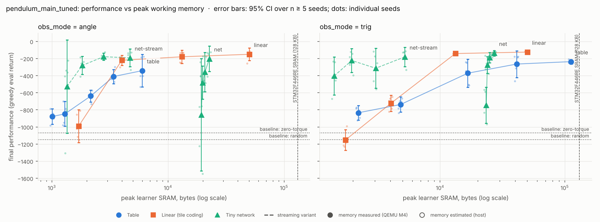
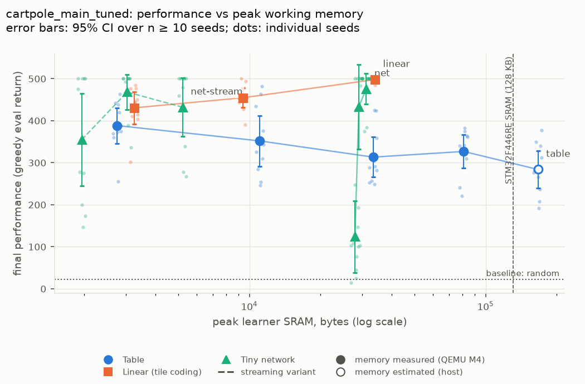
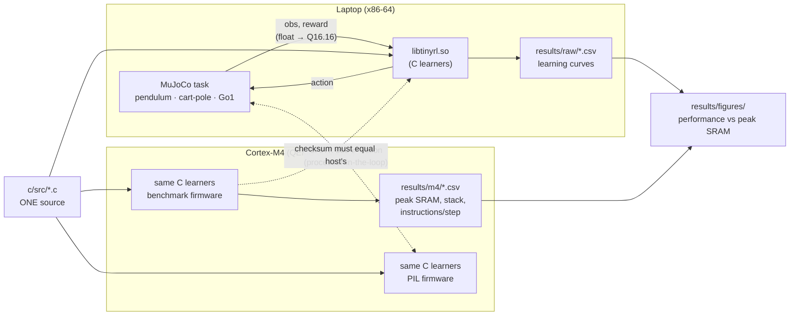

# Gait-adaptive robot: learning that fits in a microcontroller

A simulated quadruped (Unitree Go1, MuJoCo) adapts its trot to rough ground with reinforcement learners small
enough to run, **and learn**, inside a Cortex-M4's 128 KB of SRAM. Three learners written in fixed-point C — a
table, a linear model on hashed tile codings and a tiny neural network — share one learning target and are
compared on learning performance, adaptation speed and compute cost against peak working memory.

**Research question.** How do different reinforcement-learning representations trade learning performance,
adaptation speed and compute cost against peak working memory when learning online on a Cortex-M4-class platform?

> **Status (22 Nov 2026):** the core experiments (Stages 2-5) are run and written up: read
> [`docs/report.md`](docs/report.md), with every number in [`docs/results.md`](docs/results.md). Stage 4 stopped at
> its pre-registered gate with a null result. Stage 7 (Go1, simulation) missed its
> pre-registered bar: no learner beat the stumble-reflex gait. No real-hardware timing: the Nucleo build
> has never run on hardware, and QEMU counts instructions, not time.





*Final performance against peak SRAM measured on the emulated M4, 10 seeds per point.*

## Results so far

On cart-pole, linear tile coding beat the table on final return (+141.3 [+96.9, +185.7]) with less than a third of
its SRAM (9.4 KB against 33.5 KB), at 4.3x the table's instructions per step.
The streaming tiny network (about 3 KB) learned cart-pole faster than 9.4 KB of tile coding (AUC +63.6 [+26.0, +101.1],
final return inconclusive) and returned more after the pendulum's rod got heavier (+86.8 [+66.9, +106.8]), at 12-20x
linear's instructions per step, but it alone had traces and ObGD, so these gains cannot be credited to the network
itself.
Five replay updates per step did not measurably speed up the table, stochastic rounding made no detectable
difference, and on the simulated Go1 no learner beat a fixed stumble-reflex gait or differed detectably from random
nudges of its parameters.

*Caveats:* simulation and QEMU only (memory and instruction counts, no timing, no hardware); 10 seeds, 20 for
adaptation; update rule confounded with representation (D69); traces without the Watkins cut (D68); the equal-memory
comparisons are exploratory ([report §4.1](docs/report.md#41-pendulum-return-against-sram)).

A difference counts only if its paired 95% interval excludes 0. "Learned faster" = higher AUC.

| What | Finding | Strength |
|---|---|---|
| Stage 1 gate | C learner reproduces the Python Q16.16 reference bit for bit | deterministic test |
| Pendulum | replay network (27.2 KB) learned faster than linear tile coding (50.1 KB) at 74.7x the instructions; final return inconclusive | 10 seeds, not pre-registered |
| Cart-pole | linear tile coding beat the table, at 4.3x the instructions | 10 seeds, pre-registered |
| Cart-pole | streaming network (3.0 KB) learned faster than linear tile coding (9.4 KB) at 12.2x the instructions; final return inconclusive | 10 seeds, pre-registered; update rule differs (D69) |
| Adaptation | after a 50% heavier rod the streaming network returned more than linear tile coding, at 20.0x the instructions (different SRAM: 3.0 vs 13.2 KB, so no per-byte claim) | 20 seeds, pre-registered; update rule differs (D69) |
| Replay ratio | 5 replay updates per step did not measurably speed up the table, at 2.7x the instructions | 10 seeds, pre-registered gate |
| Stochastic rounding | no detectable difference. Final: table +12.3 [−36.0, +60.5], linear −1.38 [−10.00, +7.25], network −32.6 [−115.1, +49.8]. AUC: table −15.1 [−45.1, +15.0], linear +2.23 [−8.71, +13.16], network +16.0 [−33.2, +65.2] | 10 seeds, pre-registered |
| Traces (λ 0.8) | helped table (AUC +284.9 [+251.4, +318.5]) and linear (+152.1 [+132.6, +171.5]), hurt the network (−154.5 [−218.5, −90.6]); one-step network beat the full streaming recipe on final return (+149.0 [+70.7, +227.4]) | 10 seeds, untuned, exploratory (D69) |
| Go1 (simulation) | the bar was not met: no learner beat the stumble-reflex gait, and none differed detectably from random nudges | 10 seeds, pre-registered bar; random comparison exploratory |
| On-chip learning | learning on the emulated M4 reproduces host learning bit for bit (4 learner types) | deterministic test, QEMU only |

Single-seed observations from the build are in [`docs/build_notes.md`](docs/build_notes.md) and are not results.

## What is in it

| Part | Contents |
|---|---|
| Learners (`c/`) | table, hashed tile coding (FNV + finaliser, or dense), tiny ReLU network; one shared Q-learning target; optional replay (plain or compressed), target network, TD clipping, Q(λ) without the Watkins cut + ObGD step cap for all three (streaming; D68), LayerNorm, continual backprop, stochastic rounding; underflow counter |
| Tasks (`python/tinyrl/envs/`) | corridor (Stage 1), pendulum, cart-pole, Unitree Go1 trot on rough ground with a CPG, phase lock, foot contacts, reflexes (Tegotae, posture, stumble) and three action modes |
| Protocol | step budgets, 10 paired seeds, equal-budget tuning on separate seeds, baselines in every experiment, paired differences, adaptation metric with a from-scratch reference |
| Measurement | every configuration built for the Cortex-M4 and run in QEMU: peak SRAM (agent + arena + stack), instructions per step, host == M4 checksum |
| On-chip learning | processor-in-the-loop over UART: QEMU (verified) and Nucleo-F446RE (written, not yet run on hardware) |
| Docs | stages guide, architecture, decisions log with a decision review, two literature reviews + raw notes, results log, build notes, changelog |

## How it fits together



The same C files are compiled three times: for the laptop (learning curves in MuJoCo), for benchmark firmware
(memory and instruction counts in QEMU) and for processor-in-the-loop firmware (the learner learns on the chip
while the laptop only simulates the robot). Checksums and the PIL check prove all three behave identically.

## Quick start (Ubuntu 24.04)

```bash
bash scripts/setup_ubuntu.sh                    # once: apt packages, .venv, build, all tests
source .venv/bin/activate                        # every new terminal

make test                                        # C unit tests + Python tests (incl. Stage 1 gate)
python3 scripts/pil_check.py                     # learning on the emulated chip == laptop
bash scripts/run_experiment.sh stage2_pendulum_table   # tune + sweep + M4 measurement + plots
python3 scripts/results_table.py stage2_pendulum_table_tuned   # table for docs/results.md
python3 scripts/compare.py cartpole_main_tuned   # pre-registered paired differences
python3 scripts/check_docs.py                     # every table in docs/results.md, rebuilt from the archives (also in CI)
python3 scripts/view_go1.py                      # watch the robot (needs a display)
```

## Stages

| # | Stage | Command | Gate (from the project brief) |
|---|-------|---------|------|
| 1 | Corridor, Q-learning by hand → Python → C | `python3 -m tinyrl.ref.corridor_ref` (in `python/`), `make test` | C matches Python bit for bit ✅ |
| 2 | Pendulum, table learner | `run_experiment.sh stage2_pendulum_table` | if the emulator costs > 6 h, measure RAM from the binary |
| 3 | Linear + network learners | `run_experiment.sh pendulum_main`, `… stream_ablation` (`tile_collisions`: not run) | if the network will not learn stably, report it and continue with two |
| 4 | Replay ratio (compressed buffer) | `run_sweep.py replay_ratio --only table` | stopped at the gate, 22 Nov (D53): not met |
| 5 | Cart-pole + adaptation | `… cartpole_main`, `… adaptation_pendulum` (+ `_scratch`) | no plot → cut the sweep until one exists |
| 6 | Write-up | `docs/report.md`, `docs/results.md`, `docs/study_guide.md` | — |
| 7 | Gait adaptation on Go1 | `scripts/go1_difficulty.py --ladder`, `scripts/go1_es.py`, `… go1_gait_v3` | — |

What to read and what each gate means: [`docs/stages.md`](docs/stages.md).

## Repository map

```
c/include/          tr_fixed.h (Q16.16 maths), tr_rng.h (xorshift32), tinyrl.h (learner API)
c/src/              tr_agent.c (shared target, ε-greedy, replay, streaming Q(λ), no Watkins cut, +ObGD), tr_tabular.c,
                    tr_linear.c, tr_mlp.c, tr_trace.c
c/envs/, c/tests/   corridor in C; unit tests, corridor trace, host build of the M4 benchmark
m4/                 Cortex-M4 benchmark firmware: startup, linker script (F446 memory map), semihosting
m4/kernels/         candidate update kernels (D46; single measurements, not results)
m4/pil/             processor-in-the-loop firmware (QEMU and Nucleo-F446RE builds)
tools/qemu_plugin/  QEMU plugin that counts executed instructions
python/tinyrl/      cbind.py (ctypes → C), pil.py, envs/, harness.py, sweep.py, analysis.py, plots.py
python/tinyrl/ref/  Python references: bit-exact corridor mirror, float twins of the learners
configs/            one JSON per experiment (*_tuned.json are written by tune.py)
scripts/            run_experiment.sh, run_sweep.py, tune.py, measure_m4.py, make_plots.py, results_table.py,
                    pil_check.py, bench_kernels.py, tile_collisions.py, go1_difficulty.py, go1_es.py,
                    view_go1.py, setup_ubuntu.sh
results/            figures, M4 measurements and raw-log archives of reported experiments
docs/               report, results, study guide, stages, architecture, decisions, research reviews, build notes, changelog
```

## Ground rules

- No result without a measurement behind it, and no hardware, timing or power claims from QEMU. QEMU counts
  instructions, not cycles, and it is not the STM32F446RE.
- A number enters `docs/results.md` only with its seeds, commit and command; raw logs go to `results/raw_archive/`.
- Novelty wording: learning on a microcontroller is established (Elsayed, Lupu, Vasan, Mahmood, arXiv:2410.14606v3,
  21 Sep 2026: Pong on an ESP32-S3), and so is learning a gait on one. Our claim is only the controlled
  memory-vs-representation comparison: "a controlled comparison was not found in a limited search". Never "first".
- Design choices live in [`docs/decisions.md`](docs/decisions.md). Change one by adding a new entry, never by editing history.

## Credits

Go1 model: [MuJoCo Menagerie](https://github.com/google-deepmind/mujoco_menagerie), BSD-3-Clause, © Unitree Robotics.
Physics: [MuJoCo](https://mujoco.org). Tile coding follows Sutton & Barto (2018), §9.5.4.
