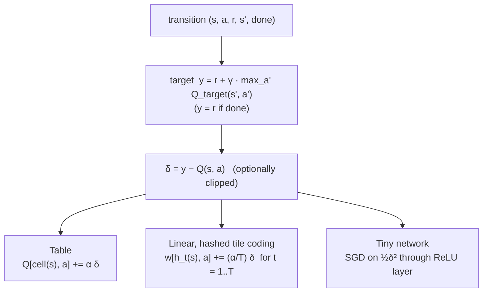
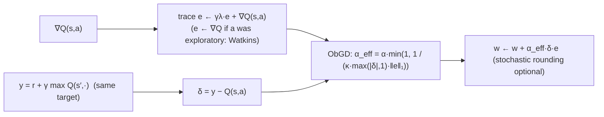
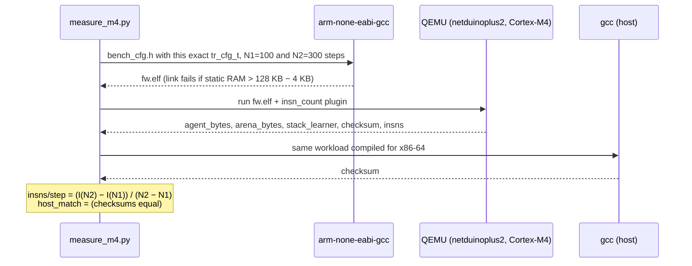

# Architecture

## 1. One learning target, three representations



Since 17 Nov there is a second, opt-in update path with the same target (`learn_stream` in `tr_agent.c`):



`tr_agent.c` computes `y` and `δ` the same way for every learner. Each learner
file only answers two questions: *what is Q(s, ·)?* and *how does δ move it?*

| | Table | Linear (tile coding) | Tiny network |
|---|---|---|---|
| Q(s,a) | one stored number | sum of T weights | W2·ReLU(W1·x + b1) + b2 |
| memory knob | `bins` per dimension | `features` M (hashed) | `hidden` H |
| parameters | bins^d · A | M · A | H·d + H + A·H + A |
| grows with state dim d | exponentially | not at all (hashing) | linearly |
| generalises between states | no | locally (overlapping tiles) | globally |
| stabilisers it may use | — | replay | replay, target net, δ clipping |

## 2. Memory model: no malloc

```
            caller-owned, static on the M4
 ┌──────────────────────┐  ┌──────────────────────────────────────────────────────────┐
 │ tr_agent_t           │  │ arena  (tr_mem_bytes(cfg) bytes, carved by tr_init)       │
 │ cfg, rng, pointers…  │  │ xn[d] │ q[A] │ replay s,s',r,a,done (opt.) │ learner part │
 │ 220–300 B on the M4  │  └──────────────────────────────────────────────────────────┘
 └──────────────────────┘     learner part: table | weights + idx[T] | W,b (+target) + z,h
 + stack while act()/observe() run  (measured by stack painting)

 peak working memory  =  sizeof(tr_agent_t)  +  arena  +  learner stack
```

Every byte is either in the arena (counted by `tr_mem_bytes`) or on the stack
(measured on the M4). `test_core.c` checks that `tr_init` carves exactly
`tr_mem_bytes` bytes.

**Not counted:** code (flash), the environment (on a robot the sensors and the
gait generator live elsewhere), startup code and `main`'s own frame.

## 3. Q16.16 fixed point

A `q16_t` is an `int32` holding `round(x · 65536)`: 16 integer bits (with
sign) and 16 fraction bits. Range ±32768, step 1/65536 ≈ 1.5·10⁻⁵.

```
  x = 2.75       →  2.75 · 65536 = 180224  = 0x0002_C000
                                              └int─┘└frac┘
  a·b            →  ((int64)a · b + 2^15) >> 16      round, then saturate to int32
  a·b·c (α·δ·x)  →  one int64 chain, rounded twice   keeps tiny steps from vanishing
```

Why it matters for learning: an update `α·δ·x` smaller than 1/65536 rounds to
zero, so learning silently stops. `q16_mul3` delays the rounding. The float
twins in `python/tinyrl/ref/float_agents.py` let you tell a fixed-point
failure from an algorithm failure.

## 4. Measurement pipeline (M4)



- **Stack painting.** Fill free RAM with `0xA5A5A5A5`, run the workload, find the
  lowest overwritten word.
- **Instruction counts** come from a TCG plugin. They are not cycles: no wait
  states, pipeline or flash accelerator are modelled. Cycle counts need the
  board's DWT counter.
- **Synthetic workload.** Observations are uniform within the bounds. Per-step
  cost does not depend on the values for these learners, except for some branch
  paths: `δ = 0` skips the network backward pass, and a ReLU that is off skips
  its row.

## 5. Tasks

| task | obs (dims) | actions | dt | episode | reward | shift (adaptation) |
|---|---|---|---|---|---|---|
| corridor | cell (1) | 2 | — | ≤ 100 steps | +1 at goal | — |
| pendulum swing-up | θ, θ̇ (2) or cos θ, sin θ, θ̇ (3) | 3 torques | 0.05 s | 200 steps | −(θ² + .1θ̇² + .001u²) | rod mass ×(1+level) |
| cart-pole | x, ẋ, θ, θ̇ (4) | 2 | 0.02 s | ≤ 500 steps | +1 / step | pole mass ×(1+level) |
| Go1 rough-ground trot | roll, pitch, ω_x, ω_y (4), opt. +v_x, z (6) | 6 gait adjustments | 0.25 s | 40 decisions | 10·Δx − 2(roll²+pitch²), −5 on fall | roughness ×(1+level) |

The Go1 learner does not output joint angles. It sits on top of a fixed CPG:

```
 learner (4 Hz)  ──action──▶  CPG + leg mapping (50 Hz)  ──targets──▶  PD joints (MuJoCo, 500 Hz)
      ▲                                                                         │
      └───────────────────── IMU: roll, pitch, roll rate, pitch rate ◀──────────┘
```
