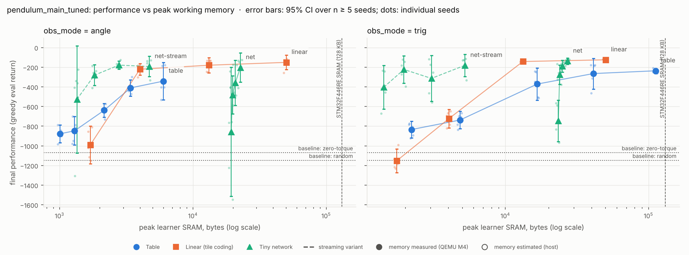
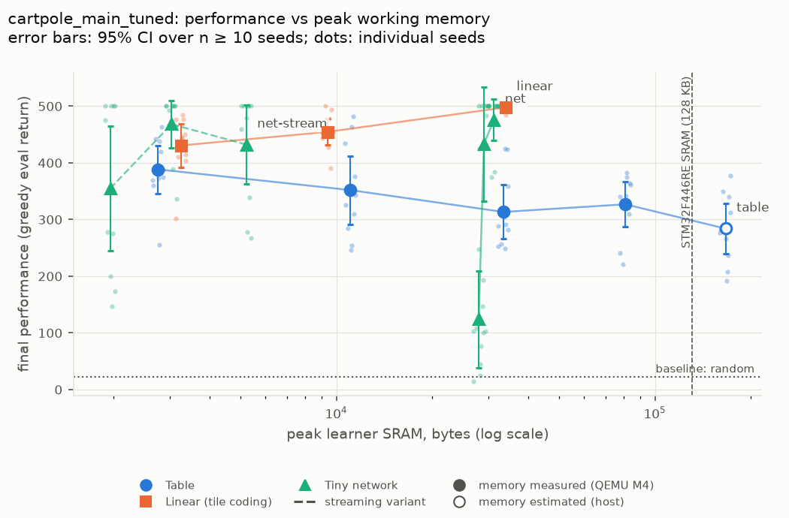
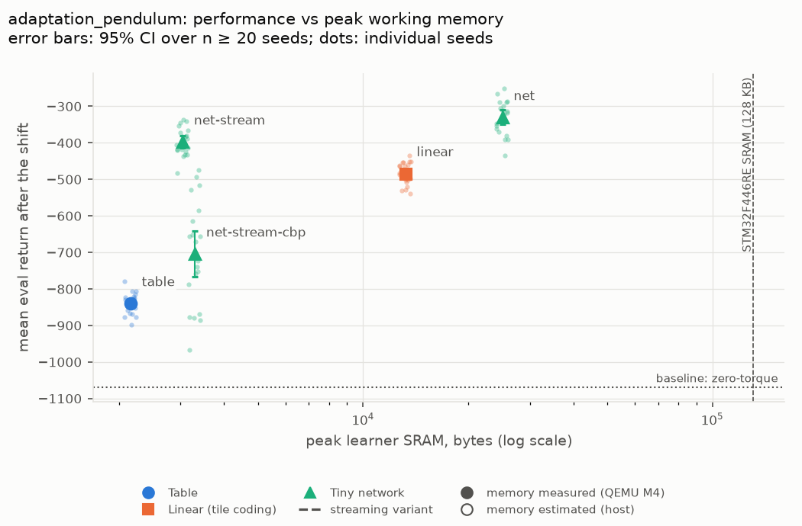
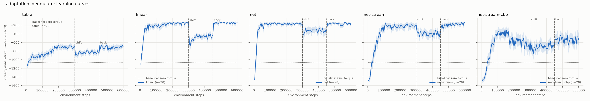

# Learning on a microcontroller's memory budget: table, tile coding or tiny network?

Every number below comes from a table or line in [`results.md`](results.md), which names its commit, config and
archive. The rules that were fixed before the runs are in [`decisions.md`](decisions.md) (D49–D60); D61–D80 were added afterwards and say so; v2 (D70), Go1 v4 (D71) and adaptation v2 (D77) were registered before their runs, and D78 is exploratory.

## Summary

When every learner could choose the same update rule (v2, D70), tile coding beat the table on cart-pole (AUC +110.0
[+88.1, +132.0], final +98.0 [+32.2, +163.8]), and the streaming tiny network's earlier cart-pole advantage over tile
coding did not reappear (AUC −17.1 [−37.5, +3.3], inconclusive; v1's +63.6 [+26.0, +101.1] came with traces for the
network only, D69).
At matched peak SRAM the answer depended on the budget: on the pendulum the best network beat the best tile coding by
far at 4 KB (AUC +489.6 [+443.3, +536.0]), where only 64 hashed features fit, but tile coding was better at 16 KB
(AUC −221.7 [−265.2, −178.1]), and on cart-pole the network was better at no budget (lower at 64 KB, AUC −61.9
[−82.4, −41.3]).
After the pendulum's rod got heavier the streaming network and tile coding did not differ detectably once each had
its own tuned update rule (+9.85 [−17.25, +36.95]; v1's +86.8 came with traces for the network only), five replay updates per step did not measurably speed up the table, stochastic
rounding made no detectable difference, and on the simulated Go1 no learner beat a fixed stumble-reflex gait, even at
a roughness where a better fixed setting was shown to exist (+4.36 [+2.59, +6.13] over it on new terrain).

*Caveats:* simulation and QEMU only (memory and instruction counts, no timing, no hardware); 10 seeds, 20 for
adaptation; 12 uncorrected matched-SRAM intervals in all (6 per task); replay and the ablation keep v1's update rules
(D69) and traces without the Watkins cut (D68).

## 1. Question

How do different reinforcement-learning representations (tabular, linear tile coding, tiny neural network) trade
learning performance, adaptation speed and compute cost against peak working memory, when learning online on a
Cortex-M4-class platform?

Learning on a microcontroller is established: Elsayed, Lupu, Vasan and Mahmood (arXiv:2410.14606v3, 21 Sep 2026)
report Stream-Q learning Pong from pixels directly on an ESP32-S3. The contribution claimed here is narrower: a
controlled comparison of representations by learning performance against peak working memory. Such a comparison was
not found in a limited search. Learning a gait on a microcontroller is not claimed (see §6).

## 2. Setup

```
 laptop (x86-64)                                        Cortex-M4 emulated in QEMU
 MuJoCo task <--> libtinyrl.so  --> learning curves     the same C files --> peak SRAM, instructions per step
                       ^                                        ^
                       +------ checksum: must be identical -----+
```

**Learners.** Three representations share one Q-learning target, y = r + γ max Q(s′, ·):

- a table over a uniform grid;
- linear function approximation on hashed tile coding (Sutton & Barto 2018, §9.5.4);
- a network with one hidden ReLU layer, in two variants. The *replay* network uses SGD, a 2,000-transition
  compressed buffer and a target network. The *streaming* network keeps no samples: it uses eligibility traces (Q(λ) without the Watkins cut,
  so the trace is not reset after an exploratory action; D68), a step-size cap (ObGD) and LayerNorm, after the December 2024 version (v2) of Elsayed et al., as described in Appendix C of v3 (2026), plus stochastic
  rounding (Gupta et al. 2015). The September 2026 version of that paper replaced ObGD by another optimiser, which
  is not studied here. Observation normalisation, reward scaling by a running statistic and sparse initialisation
  from that recipe are not used (D23, D61).

**Not the same update rule.** In the main experiments only the streaming network used traces and ObGD; the table and
linear learners did one-step Q-learning, and their tuning searched α only. The streaming net's tuning offered λ 0.6,
0.8 and 0.9 and chose 0.6, the smallest, on both tasks (D69). Every comparison with the streaming net therefore
changes the update rule as well as the representation. The v2 rerun (§4.9) removes this for the main comparisons.

**Fixed point.** All learner arithmetic is Q16.16 C with static allocation. Counters record update products that
round to zero (underflow) or clip (saturation). No measured saturation was above 0% in any experiment that recorded
it (replay ratio, cart-pole, adaptation, ablation).

**Memory.** Peak working memory = agent struct + arena + learner stack, measured on the M4 build by stack painting.
Code, environment and startup are excluded.

**What QEMU can and cannot say.** It gives memory and instruction counts. It gives no timing: no cycles, wait states,
pipeline or power. The emulated machine is an STM32F405 with the memory map of an STM32F446RE. The
processor-in-the-loop build for a Nucleo-F446RE has **never run on hardware**; processor-in-the-loop learning was
checked in QEMU only.

**Tasks.** Pendulum swing-up (2 or 3 state dimensions), cart-pole (4 dimensions, at most 500 steps) and, as an
extension, gait tuning on a simulated Unitree Go1.

## 3. Method

- **Budgets.** Equal environment steps and equal tuning effort: 20 sampled configurations per learner, 3 tuning
  seeds whose training is separate from the reporting seeds (evaluation used the same 10 start states in tuning and
  in reporting, D66), one tuning point in the middle of each memory sweep (Patterson et al.
  2023). The pendulum was tuned at a third of its step budget, cart-pole at the full budget (D49).
- **Seeds.** 10 paired seeds, 20 for adaptation, fixed before the runs. None were added after seeing a result (D50),
  because few-run comparisons are easy to over-read (Henderson et al. 2017; Colas et al. 2018; Agarwal et al. 2021).
- **Differences.** Student-t 95% interval on per-seed differences. A difference counts only if the interval excludes
  0. Otherwise it is "inconclusive".
- **Registration.** Replay ratio, cart-pole, adaptation, ablation and Go1 comparisons were written down before their
  runs. The pendulum main comparison had already been seen, so its comparisons are labelled not pre-registered. The
  Stage 4 metric changed from steps-to-threshold to AUC before the run and after the no-replay pendulum results were
  seen. Both metrics give the same decision (D53).
- **Metrics.** Final = mean of the last 3 greedy evaluations. AUC = mean evaluation over training. Online = mean
  training return over the last 20% of episodes.

## 4. Results

Every comparison with the streaming network in §4.1, §4.2, §4.4 and §4.8 is also a comparison of update rules (D69). §4.9 repeats the main comparisons with the same choice of update rule for every learner.

### 4.1 Pendulum: return against SRAM



**Equal-memory comparisons, both tasks (exploratory, D63).** On two tasks, with the same number of tuning draws per
learner (but different search spaces, D69), the streaming net showed no detectable difference in final return from
linear tile coding at approximately 3-10x less SRAM in 7 of the 10 configuration pairs in that band, and was lower in
the other 3 (all pendulum). It learned more slowly (lower AUC) in all 7 pendulum pairs; on cart-pole one of 3 was
faster, one inconclusive, one slower. At about equal SRAM (within 1.5x) there are 9 pairs (8 pendulum, 1 cart-pole): final return favoured the streaming
net in 6 (all pendulum) and showed no detectable difference in 3, and AUC favoured it in 8 and showed none in 1.
All 6 are against linear configurations that scored −769 or worse, two of them near the random policy (−1157 against
−1147). Against linear's better input encoding no difference was detected at about 4 KB (linear −224, 4 pairs); at
1.7 KB, where linear's best is −961, the streaming net was higher (4 pairs).
These memory comparisons are exploratory (D63): 19 pairs reported out of 41 examined, plus a check against linear's
better encoding on final return. That is 86 uncorrected 95% intervals, so if no true difference existed about two
"detectable" differences per metric, about four in total, would be expected by chance. Read the counts, not any one pair.
"No detectable difference" does not mean equal.
These pairs also differ in update rule: only the streaming net had traces and ObGD (D69).

- Replay network (27.2 KB) against linear tile coding (50.1 KB): final return inconclusive (−8.73 [−25.28, +7.82]). The
  network learned faster (AUC +40.9 [+20.6, +61.2]) at 74.7x the instructions per step. *Not pre-registered.*
- Descriptively, the streaming networks hold the mean final-return frontier between 1.3 and 5.2 KB. Linear coding
  and the replay network hold it from 13.3 KB. The table is on it only at 1,008 B and 1,296 B.
- The table's mean return rises with its size (−948 ± 47 at 1.0 KB to −245 ± 70 at 12.2 KB in the table-only
  experiment), and it did not reach the usual solved level within 300k steps.
- The input encoding matters: with cos/sin the 21-bin table costs 111.8 KB instead of 6.0 KB.

### 4.2 Cart-pole: return against SRAM



| A − B | final return | AUC | instructions, A / B |
|---|---|---|---|
| linear 1,024 (9.4 KB) − table 8 bins (33.5 KB) | +141.3 [+96.9, +185.7], higher | +80.4 [+53.0, +107.8], higher | 4.3x |
| replay net 32 (29.1 KB) − linear 1,024 | −21.3 [−128.6, +86.0], inconclusive | −114.4 [−160.9, −67.9], lower | 27.8x |
| streaming net 32 (3.0 KB) − linear 1,024 | +13.5 [−37.2, +64.3], inconclusive | +63.6 [+26.0, +101.1], higher | 12.2x |

The table gains nothing visible from more memory here. At 12 bins it no longer fits in 128 KB.

### 4.3 Compute

| learner | pendulum, instructions per step | cart-pole, instructions per step |
|---|---|---|
| table | 525–644 | 708–715 |
| linear tile coding | 1,815–2,003 | 3,049–3,053 |
| streaming network, 8/16–64 hidden | 10,530–68,884 | 20,500–71,974 |
| replay network, 8/16–64 hidden | 24,426–149,541 | 47,571–159,046 |

These are QEMU instruction counts on a synthetic workload, not times, re-measured on 22 Nov after the linear
learner's feature cache was fixed (D62): it hashes once per step, whatever path the benchmark takes.

### 4.4 Adaptation: A → B → A





**v1** (only the streaming net had traces and ObGD, D69):

| learner | peak SRAM | post-shift AUC | forward transfer | forgetting |
|---|---|---|---|---|
| table | 2,160 B | −840 ± 12 | +101.7 [+84.5, +118.9] | −106.8 [−223.4, +9.8], inconclusive |
| linear | 13,220 B | −484 ± 13 | +108.4 [+84.3, +132.5] | −164.6 [−226.6, −102.5], forgot |
| replay net | 25,068 B | −330 ± 20 | +182.7 [+157.6, +207.8] | −104.0 [−216.4, +8.4], inconclusive |
| streaming net | 3,048 B | −397 ± 16 | +341.6 [+310.7, +372.6] | −152.0 [−257.6, −46.5], forgot |
| streaming net + continual backprop | 3,304 B | −704 ± 62 | +233.0 [+161.4, +304.5] | +61.0 [−126.3, +248.2], inconclusive |

- Streaming network − linear, post-shift AUC: +86.8 [+66.9, +106.8], at 20.0x the instructions, with different SRAM (3,048 B and 13,220 B).
- Continual backprop (Dohare et al. 2024; comparison pre-registered, its own two parameters untuned) at one setting made the streaming network worse after the shift
  (−306.8 [−369.7, −244.0]). It was already degrading before the shift, so this is not a verdict on the method.
- Over the whole second A window no learner differed measurably from its pre-shift level.
- Forward transfer includes the fresh learner's exploration cost.

**v2 (D77).** The same experiment with every learner's hyperparameters from v2's tuning (§4.9); v2 chose no traces
and no ObGD for the streaming net here, so it ran as a one-step network with LayerNorm and stochastic rounding.
Streaming net − linear on post-shift AUC: +9.85 [−17.25, +36.95], inconclusive. The v1 advantage did not hold up.
Continual backprop again made the streaming net worse after the shift (−450.3 [−569.0, −331.5]). Every learner
transferred forward; table and linear forgot measurably, the networks' forgetting intervals include 0
(results.md, "Adaptation v2").

### 4.5 Replay ratio: a null result

5 replay updates per step did not measurably speed up learning (AUC difference +25, 95% CI [-22, +72], 10 paired seeds) at 2.7x the instructions per step.

Both arms learned from the same 1,000-transition buffer, so this compares n = 5 with n = 1, not replay with the plain
table. It does not show that replay is useless: the interval reaches +72. The linear and network arms were not run,
as the stop rule required.

### 4.6 Underflow and stochastic rounding

In the pendulum comparison the streaming networks round 24–51% of their update products to zero, the table at most
0.4%. The ablation switched stochastic rounding on and off within each learner:

| learner with traces | underflow without it | final, with − without | AUC, with − without |
|---|---|---|---|
| table | 64.5% | +12.3 [−36.0, +60.5] | −15.1 [−45.1, +15.0] |
| linear | 22.8% | −1.38 [−10.00, +7.25] | +2.23 [−8.71, +13.16] |
| network | 33.8% | −32.6 [−115.1, +49.8] | +16.0 [−33.2, +65.2] |

All six show no detectable difference: each interval includes 0. Added after the results (exploratory, D69): traces
helped the table and linear learners and hurt the network (AUC +284.9, +152.1, −154.5), and the one-step network beat
the full recipe on final return (+149.0 [+70.7, +227.4]). The same experiment shows that bootstrapping is needed on this task: with γ = 0 the table
and linear learners end 820 and 1,006 below their Q-learning twins.

### 4.7 Reproducibility

190 runs repeated on a second x86-64 Linux machine were byte-identical. For every configuration measured on the M4
the host and M4 checksums are equal. This shows determinism, not correctness, and says nothing about ARM or macOS
hosts.

### 4.8 Extension: tuning the Go1's gait (simulation)

The learner nudges three parameters of a trot that already has a stumble reflex. The bar, fixed before the run, was
to beat both that reflex gait (B3) and the all-reflex gait (B4).

| learner | peak SRAM | final | − B3 | − B4 | − random nudges (exploratory) |
|---|---|---|---|---|---|
| table | 29,420 B | 16.4 ± 2.1 | −2.84 [−4.96, −0.71], lower | +4.49 [+2.36, +6.62], higher | −0.77 [−4.27, +2.74] |
| linear 1,024 | 30,348 B | 17.1 ± 4.4 | −2.08 [−6.53, +2.36] | +5.24 [+0.80, +9.69], higher | −0.01 [−4.29, +4.27] |
| linear 4,096 | 116,364 B | 15.2 ± 4.5 | −4.05 [−8.59, +0.49] | +3.28 [−1.26, +7.82] | −1.98 [−7.33, +3.38] |
| streaming net 16 | 3,436 B | 17.3 ± 4.0 | −1.87 [−5.90, +2.16] | +5.45 [+1.42, +9.48], higher | +0.20 [−5.08, +5.48] |
| streaming net 32 | 5,932 B | 18.5 ± 4.1 | −0.69 [−4.78, +3.40] | +6.64 [+2.55, +10.72], higher | +1.38 [−3.52, +6.28] |

**The bar is not met.** No learner beat B3. Beating B4 is no evidence of learning, because random nudges score like
the learners. Evaluation used the same 5 terrains for every seed, so this holds for those terrains only.

**v4, with headroom shown first (D71, D74, D75).** v3's roughness 0.10 turned out to offer nothing to find: the
best fixed setting the learner can reach was inconclusive against B3 on new terrain (+0.37 [−3.83, +4.57]). At 0.08
it was not (+4.36 [+2.59, +6.13]), so v4 ran there, every learner with the same update rule, scored on 30 held-out
terrains:

| learner | − B3 (registered bar) | − random nudges | − B-best (the better fixed setting) |
|---|---|---|---|
| table | −1.10 [−2.73, +0.52] | +3.57 [+1.70, +5.44], higher | −4.98 [−6.60, −3.36], lower |
| linear 1,024 | −0.13 [−0.96, +0.70] | +4.54 [+3.11, +5.97], higher | −4.00 [−4.83, −3.18], lower |
| linear 4,096 | +0.56 [−0.35, +1.48] | +5.24 [+4.11, +6.36], higher | −3.31 [−4.23, −2.39], lower |
| streaming net 16 | −0.78 [−2.62, +1.05] | +3.89 [+1.37, +6.40], higher | −4.66 [−6.49, −2.83], lower |
| streaming net 32 | −0.54 [−1.99, +0.92] | +4.13 [+2.95, +5.32], higher | −4.41 [−5.87, −2.96], lower |

**The bar is again not met**, though this time there was something to find. The learners beat chance but did not
reach the better setting in 20,000 untuned steps.

### 4.9 v2: the same choice of update rule for every learner

Registered before the run (D70). Table, tile coding and the streaming network each tuned λ, κ and (with ObGD off) α
from the same grids, with the Watkins cut; a one-step network (`net-sgd`) was added; every learner had K = 40 draws
at the full budget on tuning seeds and tuning evaluation states of its own (D66). Tables: results.md, "v2".

| comparison | metric | difference, 95% CI | verdict |
|---|---|---|---|
| cart-pole: linear 1,024 − table 8 bins | AUC | +110.0 [+88.1, +132.0] | linear higher |
| cart-pole: streaming net 32 − linear 1,024 | AUC | −17.1 [−37.5, +3.3] | inconclusive |
| cart-pole: replay net 32 − linear 1,024 | AUC | −145.8 [−192.0, −99.7] | net lower |
| pendulum: streaming net 32 (angle) − linear 256 (angle) | AUC | +140.2 [+93.4, +187.1] | net higher |
| pendulum: replay net 64 (trig) − linear 4,096 (trig) | final | −43.2 [−80.1, −6.3] | net lower |

**Best network − best linear at matched peak SRAM** (each family's entry chosen on the tuning seeds only):

| task, budget | network (B) | linear (B) | AUC difference | final difference |
|---|---|---|---|---|
| pendulum, 4 KB | streaming 32, trig (2,152) | 64 features, angle (2,200) | +489.6 [+443.3, +536.0] | +565.5 [+483.2, +647.9] |
| pendulum, 16 KB | streaming 32, trig (2,152) | 1,024 features, angle (13,720) | −221.7 [−265.2, −178.1] | −31.2 [−59.7, −2.7] |
| pendulum, 64 KB | replay 64, trig (27,248) | 1,024 features, angle (13,720) | −7.7 [−24.4, +9.1] | −38.5 [−76.5, −0.6] |
| cart-pole, 6 KB | streaming 32 (3,044) | 256 features (4,268) | +1.9 [−32.8, +36.6] | −56.5 [−186.6, +73.6] |
| cart-pole, 16 KB | streaming 32 (3,044) | 1,024 features (10,412) | −17.1 [−37.5, +3.3] | −51.1 [−151.1, +49.0] |
| cart-pole, 64 KB | streaming 32 (3,044) | 4,096 features (34,988) | −61.9 [−82.4, −41.3] | −114.0 [−218.7, −9.3] |

**What changed from v1.** With traces open to every learner, the streaming network no longer learned cart-pole
faster than tile coding. On the pendulum the network's advantage is real only where tile coding has too few features
to learn; with 16 KB, tile coding was better. On the pendulum the streaming network's tuning chose no traces and no
ObGD (λ 0, κ 0) on both encodings, so its pendulum results are those of a one-step network with LayerNorm and
stochastic rounding. With 12 uncorrected matched-SRAM intervals in all (6 per task), about 0.6 could exclude 0 by chance.

*Exploratory (D78):* re-tuning tile coding with a wider grid (λ up to 0.98, κ up to 6) chose the same values on the
angle encoding, so the 16 KB result is unchanged; on trig it again chose the largest κ offered.

## 5. Limitations

- **No hardware.** No timing, cycles, energy or power. The Nucleo build never ran.
- **Evaluation is not passive.** Greedy test episodes break ties with the learner's own random numbers, so the
  training that follows depends on the evaluation schedule (D66). Within one experiment every learner has the same
  schedule; across experiments with different schedules, a learner with the same settings can learn differently.
- **Tuning saw the test states.** Tuning and reporting were evaluated on the same 10 start states, so each tuned
  setting was chosen on the states it is later scored on (D66). v2 tuned on states of its own.
- **No Watkins cut.** Every learner with traces ran Q(λ) without the Watkins cut: the trace is not reset after an
  exploratory action, unlike the authors' code (D68). v2 (§4.9) used the cut; the other experiments did not.
- **QEMU is not timing.** Instructions are not cycles, and the workload behind the counts is synthetic.
- **One machine type.** x86-64 Linux for learning, one emulated Cortex-M4 for measurement.
- **Tuning budget.** 20 draws, one tuning point per sweep. The pendulum was tuned on a third of the budget and on
  one encoding. Several winners sit on the edge of their search space, and the streaming network's 20 draws covered
  only 9 distinct settings. Replay ratio and adaptation reuse the pendulum's values; the ablation is untuned.
- **Small scope.** Two control tasks for the core question, one shift size, one replay table and buffer size.
- **Statistical power.** With 10 seeds many intervals are tens of return units wide. Inconclusive does not mean
  equal. No correction for multiple comparisons was made.
- **Go1.** Untuned, simulation only. v3: one roughness, 5 evaluation terrains. v4: one roughness (0.08), 30 held-out terrains.
- **Ceiling.** Cart-pole's 500-step limit compresses the differences between good learners.
- **Measurement detail.** The instruction counts come from a 200-step window of a synthetic workload. The flash figures are for
  a firmware that contains all three learners.

## 6. Related work

Elsayed, Lupu, Vasan and Mahmood (arXiv:2410.14606v3, 21 Sep 2026) showed that deep RL can learn from a stream, without a buffer, by combining normalisation,
representation stabilisation and controlled updates, and report Stream-Q learning Pong from pixels directly on an
ESP32-S3 microcontroller (512 KB of SRAM). Their continuous-control benchmark networks are larger (for
example two layers of 128 units). This project tested a reduced form of their earlier recipe at 8–64 units in fixed
point. Gallici et al. (2024) give theory and evidence
that LayerNorm can replace target networks in temporal-difference learning. Sutton & Barto (2018) describe hashing
as a way to free tile coding's memory from the state dimension, which is the memory knob used here. Gupta et al.
(2015) trained networks in 16-bit fixed point with stochastic rounding; here, at 32 bits, rounding made no detectable
difference (§4.6 has the intervals). Dohare et al. (2024) introduced continual backpropagation against loss of plasticity. RLtools (Eschmann
et al. 2023) reports training deep RL directly on a microcontroller. For legged robots, CPG-RL (Bellegarda & Ijspeert
2022) lets a policy modulate oscillators and not joints, which is the structure of the Go1 extension here.

On-microcontroller gait learning is not new either. A 2016 hobby project (Counterfeiter 2016; described by Williams
2016) taught a four-servo robot to walk with Q-learning and a small neural network trained on a Cortex-M4. In this project the Go1 learner runs on
the laptop in simulation; the same C code is only measured on an emulated M4. So no on-microcontroller gait-learning
claim is made.

The claim is limited to a controlled comparison of table, linear tile coding and tiny network on learning
performance against peak working memory. It was not found in a limited search: we saw no such comparison in the parts we read
of the work above (for most of it, the abstract only).

## 7. Conclusion

At approximately 3-10x less SRAM the streaming net showed no detectable difference from linear tile coding in final
return in 7 of 10 pairs but learned more slowly on the pendulum, and at equal SRAM it was not shown to differ in final
return from linear's better encoding once linear had the 4 KB it needs to learn (exploratory: counts and caveats in
[§4.1](#41-pendulum-return-against-sram)). These v1 comparisons mix representation and update rule (D69). In v2, with the same
choice of λ and κ for every learner (§4.9), the streaming net's cart-pole advantage did not reappear, and on the
pendulum the best network beat the best tile coding only at 4 KB, where tile coding has too few features.

- The streaming net pays 12.2x to 20.0x linear's instructions per step in the v1 registered comparisons, where
  linear had no traces; in v2, where linear also uses traces, 1.3x to 2.1x. Its returns vary more between seeds.
- Linear tile coding beat the table on cart-pole with less memory, at 4.3x the table's instructions (v1) and
  11.5x (v2).
  The table is the cheapest per step.
- More replay updates were not shown to speed up the one table tested (AUC +24.6 [−22.4, +71.5]).
- Stochastic rounding made no detectable difference: table +12.3 [−36.0, +60.5], linear −1.38 [−10.00, +7.25], network −32.6 [−115.1, +49.8] on final return; table
  −15.1 [−45.1, +15.0], linear +2.23 [−8.71, +13.16], network +16.0 [−33.2, +65.2] on AUC.

- As a gait tuner on the simulated Go1 no learner beat a fixed stumble reflex, even where a better fixed setting
  existed (v4), so learning was not shown to be worth its memory there.

Whether the instruction counts fit a real control period is a question for the board, which this project has not
answered.

## References

Only sources that were opened for this report are listed. For those marked (abstract) only the abstract was read.

- Agarwal, R. et al. (2021). *Deep Reinforcement Learning at the Edge of the Statistical Precipice.* arXiv:2108.13264. (abstract)
- Bellegarda, G. & Ijspeert, A. (2022). *CPG-RL: Learning Central Pattern Generators for Quadruped Locomotion.* arXiv:2211.00458. (abstract)
- Colas, C., Sigaud, O. & Oudeyer, P.-Y. (2018). *How Many Random Seeds? Statistical Power Analysis in Deep Reinforcement Learning Experiments.* arXiv:1806.08295. (abstract)
- Counterfeiter (2016). *Q-LearningRobot.* Source code at commit 707c9cd, https://github.com/Counterfeiter/Q-LearningRobot/blob/707c9cd7d04364997a36479439ca966edae6762a/Src/ann.c
  (README and `Src/ann.c` read).
- Dohare, S. et al. (2024). *Loss of plasticity in deep continual learning.* Nature, doi:10.1038/s41586-024-07711-7. (abstract)
- Elsayed, M., Lupu, E. S., Vasan, G. & Mahmood, A. R. (2026). *Streaming Deep Reinforcement Learning Finally Works.* arXiv:2410.14606v3, 21 Sep 2026 (read in part: abstract, method, Appendix C on the earlier version, Appendix E.5 on the ESP32-S3).
- Eschmann, J., Albani, D. & Loianno, G. (2023). *RLtools: A Fast, Portable Deep Reinforcement Learning Library for Continuous Control.* arXiv:2306.03530. (abstract)
- Elsayed, M. et al. *streaming-drl* (code). https://github.com/mohmdelsayed/streaming-drl, branch 2026, commit 9326fc3
  (`stream_q.py` and `optimizer.py` read for the trace reset only).
- Gallici, M. et al. (2024). *Simplifying Deep Temporal Difference Learning.* arXiv:2407.04811. (abstract)
- Gupta, S. et al. (2015). *Deep Learning with Limited Numerical Precision.* ICML, PMLR 37. (abstract)
- Henderson, P. et al. (2017). *Deep Reinforcement Learning that Matters.* arXiv:1709.06560. (abstract)
- Patterson, A. et al. (2023). *Empirical Design in Reinforcement Learning.* arXiv:2304.01315. (abstract)
- Sutton, R. S. & Barto, A. G. (2018). *Reinforcement Learning: An Introduction*, 2nd ed., §9.5.4.
- Williams, E. (2016). *Train Your Robot To Walk With A Neural Network.* Hackaday, 11 Dec 2016,
  https://hackaday.com/2016/12/11/train-your-robot-to-walk-with-a-neural-network/ (page fetched 22 Nov 2026; secondary source).
