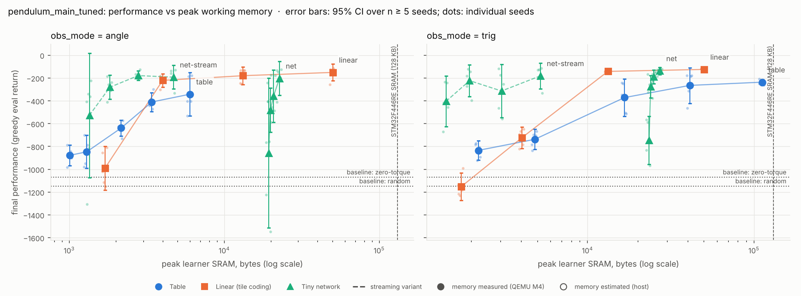
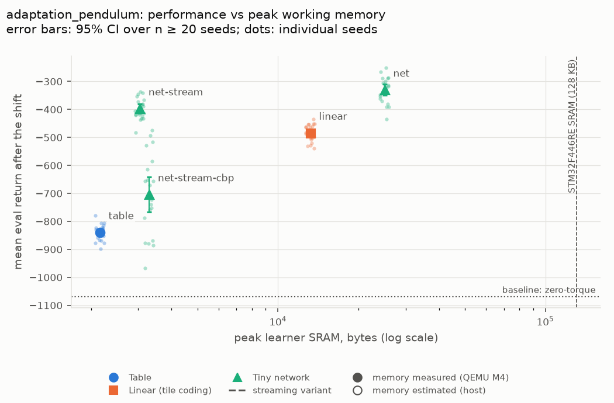
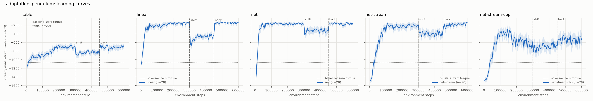
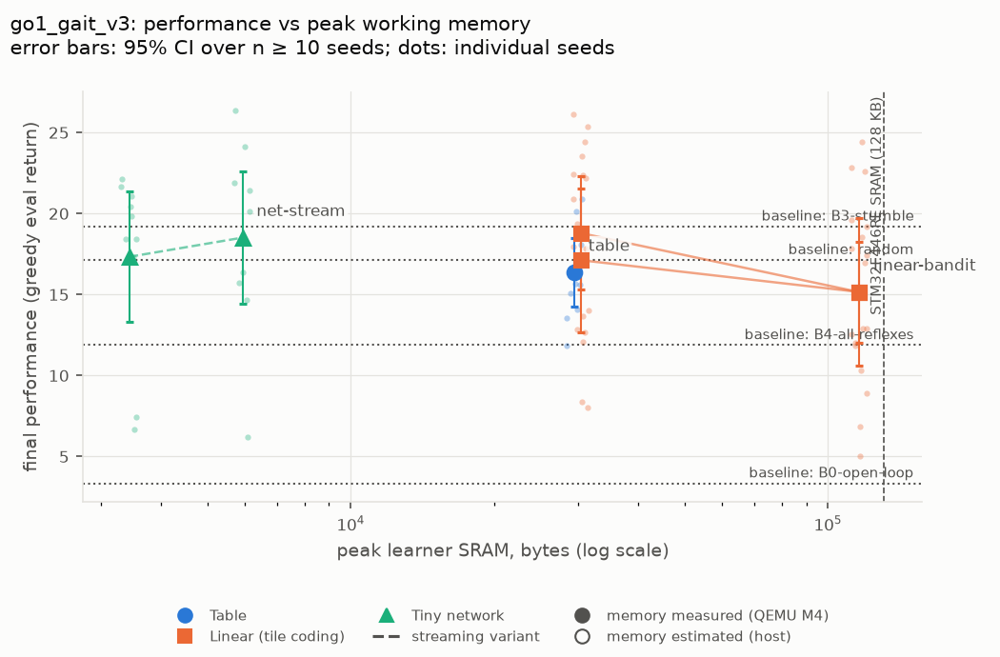

# Results log

Rule: an entry exists only if it was measured, with ≥ 5 seeds where learning
is involved, and it records **date, git commit, config file, exact command, n**.
Single-seed observations from the build are in `build_notes.md`, not here.

| date | stage | claim | numbers (mean ± 95% CI, n) | commit | command / config | figure |
|------|-------|-------|----------------------------|--------|------------------|--------|
| 17 Nov 2026 | 1 | C tabular learner reproduces the Python Q16.16 reference bit for bit on the corridor | 15/15 seed×ε cases identical | 0e0a247 | `make test` | — |
| 17 Nov 2026 | 2 | Pendulum, table learner: mean final greedy return rises with table resolution (not tested pairwise), and memory grows with bins² | 5 bins (1,008 B): −948 ± 47 · 7 (1,296 B): −933 ± 82 · 11 (2,160 B): −770 ± 41 · 15 (3,408 B): −582 ± 70 · 21 (6,000 B): −345 ± 63 · 31 (12,240 B): −245 ± 70 · random −1,147 ± 20 · zero torque −1,068; n = 10 seeds, t 95%, 300k steps, α tuned (0.45, K = 20) | ff8d592 (learner code; runs by Claude in the cloud workspace) | `bash scripts/run_experiment.sh stage2_pendulum_table` | `results/figures/stage2_pendulum_table_tuned_*.png` |
| 17 Nov 2026 | 2 | Table learner cost on the Cortex-M4 (QEMU) is flat in table size | 523–535 instructions per act + learn step; peak SRAM as above; host == M4 bit-exact for all 6 configs | ff8d592 | same | `_compute.png` |
| 17 Nov 2026 | M4 | Learning on the emulated chip (processor-in-the-loop) reproduces host learning bit for bit | 4/4 learners (table, linear, compressed-replay net, stream net), 2,000 pendulum steps each | 1e15897 | `python3 scripts/pil_check.py` | `results/m4/pil_check.json` |

Notes on the Stage 2 entry: no table configuration reached the usual "solved" level (≈ −150) within
300k steps; the largest table was still improving (see the curves). The tuning budget (100k steps) is
shorter than the table needs (D29; from 22 Nov tuning uses the full budget, D49).

## Stage 3: pendulum, all learners, both input encodings (18 Nov 2026, written up 22 Nov)

A first pass with 5 seeds (17 Nov, `c3888b4`, archived at `4efe16f`) came before this 10-seed run; finding 1 compares them.
Its run metadata records `42a5157`, a pre-rewrite commit with the identical file tree as `c3888b4` (tree `6ff4968`).

**Provenance.** Results committed in `c3f4a55` · seeds 0–9, 300,000 environment steps · tuning: K = 20 draws per learner,
seeds 1000–1002, 100,000 steps (`results/tuning/pendulum_main.csv`) · runs
`results/raw_archive/pendulum_main_tuned.tar.gz` · log `results/logs/pendulum_main.log` · library versions were not
recorded with this run · instructions and memory `results/m4/pendulum_main_tuned.csv` (QEMU, synthetic workload;
instruction counts, not timing) · tables by `scripts/results_table.py` and `scripts/compare.py`.

**pendulum_main_tuned** · commit `3e55364` · config `configs/pendulum_main_tuned.json` · command `bash scripts/run_experiment.sh pendulum_main` · seeds per config: 10–10 · intervals: t 95%

| config | final eval return | mean eval (AUC) | online return | peak SRAM (B) | instr./step (M4) | update underflow | flash, bench firmware with all three learners (B) |
|---|---|---|---|---|---|---|---|
| table_obs_modeangle_bins5 | -935 ± 70 | -1028 ± 16 | -965 ± 13 | 1008 | 525 | 0.0% | 15576 |
| table_obs_modeangle_bins7 | -850 ± 72 | -936 ± 19 | -859 ± 10 | 1296 | 525 | 0.0% | 15576 |
| table_obs_modeangle_bins11 | -669 ± 42 | -828 ± 18 | -765 ± 25 | 2160 | 529 | 0.0% | 15576 |
| table_obs_modeangle_bins15 | -460 ± 91 | -676 ± 28 | -609 ± 20 | 3408 | 532 | 0.0% | 15576 |
| table_obs_modeangle_bins21 | -327 ± 95 | -508 ± 21 | -393 ± 19 | 6000 | 534 | 0.0% | 15576 |
| table_obs_modetrig_bins5 | -854 ± 51 | -951 ± 20 | -866 ± 17 | 2212 | 634 | 0.0% | 15564 |
| table_obs_modetrig_bins7 | -698 ± 49 | -834 ± 18 | -757 ± 16 | 4828 | 639 | 0.0% | 15564 |
| table_obs_modetrig_bins11 | -363 ± 87 | -582 ± 33 | -493 ± 19 | 16684 | 641 | 0.0% | 15564 |
| table_obs_modetrig_bins15 | -250 ± 85 | -486 ± 31 | -360 ± 8 | 41212 | 644 | 0.0% | 15564 |
| table_obs_modetrig_bins21 | -227 ± 18 | -549 ± 21 | -363 ± 12 | 111844 | 639 | 0.3% | 15568 |
| linear_obs_modeangle_features64 | -961 ± 94 | -1110 ± 36 | -1135 ± 62 | 1700 | 1815 | 0.0% | 15576 |
| linear_obs_modeangle_features256 | -224 ± 35 | -458 ± 23 | -364 ± 19 | 4004 | 1820 | 0.2% | 15576 |
| linear_obs_modeangle_features1024 | -158 ± 35 | -231 ± 10 | -222 ± 5 | 13220 | 1820 | 0.5% | 15576 |
| linear_obs_modeangle_features4096 | -151 ± 37 | -219 ± 11 | -218 ± 7 | 50084 | 1824 | 0.5% | 15576 |
| linear_obs_modetrig_features64 | -1157 ± 49 | -1135 ± 24 | -1222 ± 23 | 1744 | 1996 | 0.0% | 15564 |
| linear_obs_modetrig_features256 | -769 ± 72 | -964 ± 36 | -933 ± 48 | 4048 | 1996 | 0.0% | 15564 |
| linear_obs_modetrig_features1024 | -143 ± 8 | -321 ± 12 | -251 ± 9 | 13264 | 1996 | 0.5% | 15564 |
| linear_obs_modetrig_features4096 | -124 ± 5 | -219 ± 13 | -185 ± 3 | 50128 | 2003 | 2.4% | 15564 |
| net_obs_modeangle_hidden8 | -625 ± 350 | -832 ± 201 | -756 ± 242 | 19356 | 24426 | 1.7% | 15576 |
| net_obs_modeangle_hidden16 | -574 ± 260 | -578 ± 228 | -531 ± 244 | 19836 | 40088 | 3.4% | 15576 |
| net_obs_modeangle_hidden32 | -381 ± 109 | -435 ± 78 | -406 ± 76 | 20796 | 71321 | 7.3% | 15576 |
| net_obs_modeangle_hidden64 | -226 ± 85 | -276 ± 26 | -248 ± 18 | 22716 | 135233 | 12.1% | 15576 |
| net_obs_modetrig_hidden8 | -868 ± 138 | -881 ± 70 | -835 ± 98 | 23436 | 27262 | 0.9% | 15564 |
| net_obs_modetrig_hidden16 | -293 ± 77 | -426 ± 50 | -378 ± 28 | 23980 | 44823 | 3.8% | 15564 |
| net_obs_modetrig_hidden32 | -177 ± 31 | -215 ± 30 | -243 ± 15 | 25068 | 80043 | 7.2% | 15564 |
| net_obs_modetrig_hidden64 | -133 ± 14 | -178 ± 10 | -200 ± 6 | 27244 | 149541 | 11.3% | 15564 |
| net-stream_obs_modeangle_hidden8 | -450 ± 237 | -857 ± 103 | -466 ± 124 | 1348 | 10530 | 28.7% | 15576 |
| net-stream_obs_modeangle_hidden16 | -262 ± 63 | -582 ± 57 | -280 ± 50 | 1828 | 17639 | 37.0% | 15576 |
| net-stream_obs_modeangle_hidden32 | -172 ± 32 | -412 ± 56 | -213 ± 12 | 2788 | 32081 | 44.6% | 15576 |
| net-stream_obs_modeangle_hidden64 | -171 ± 45 | -328 ± 24 | -203 ± 5 | 4708 | 61430 | 50.6% | 15576 |
| net-stream_obs_modetrig_hidden8 | -433 ± 164 | -858 ± 155 | -582 ± 126 | 1416 | 11826 | 24.3% | 15564 |
| net-stream_obs_modetrig_hidden16 | -202 ± 65 | -485 ± 30 | -327 ± 25 | 1960 | 19784 | 32.2% | 15564 |
| net-stream_obs_modetrig_hidden32 | -241 ± 115 | -384 ± 36 | -283 ± 23 | 3048 | 36413 | 40.2% | 15564 |
| net-stream_obs_modetrig_hidden64 | -158 ± 48 | -389 ± 29 | -246 ± 9 | 5224 | 68884 | 50.1% | 15564 |
| random_obs_modeangle | -1147 ± 20 | -1133 ± 5 | -1233 ± 12 | — | — | — | — |
| random_obs_modetrig | -1147 ± 20 | -1133 ± 5 | -1233 ± 12 | — | — | — | — |
| zero-torque_obs_modeangle | -1068 ± 0 | -1068 ± 0 | -1229 ± 11 | — | — | — | — |
| zero-torque_obs_modetrig | -1068 ± 0 | -1068 ± 0 | -1229 ± 11 | — | — | — | — |

**Metrics.** Final = mean of the last 3 evaluations (10 episodes each). AUC = mean evaluation return over training
(30 evaluations; higher = learned sooner). Online = mean training return over the last 20% of episodes.

**Reproducibility.** The 190 runs shared with the first pass (cloud) are byte-identical to this laptop run, episode
and evaluation files alike. That shows determinism on x86-64 Linux, not correctness; ARM and macOS are untested.

**Paired differences.** This experiment was not pre-registered: both comparisons were chosen after seeing the
results, and stay at 10 seeds (D50).

| A − B | metric | status | pairs | mean | 95% CI | verdict |
|---|---|---|---|---|---|---|
| net_obs_modetrig_hidden64 − linear_obs_modetrig_features4096 | final | not pre-registered | 10 | -8.73 | [-25.28, +7.82] | inconclusive |
| net_obs_modetrig_hidden64 − linear_obs_modetrig_features4096 | auc | not pre-registered | 10 | +40.9 | [+20.6, +61.2] | A higher |
| net-stream_obs_modeangle_hidden32 − linear_obs_modeangle_features256 | final | not pre-registered | 10 | +51.4 | [-2.9, +105.8] | inconclusive |
| net-stream_obs_modeangle_hidden32 − linear_obs_modeangle_features256 | auc | not pre-registered | 10 | +45.4 | [-7.9, +98.8] | inconclusive |

**Findings** (one task, equal tuning budget).

1. The first pass held for final and online return: all 38 ten-seed means lie inside their 5-seed intervals. For AUC
   37 of 38 do; the exception is linear, angle, 256 features (moved by −20.0, 5-seed half-width 17.9).
2. The replay network (cos/sin, 64 hidden, 27.2 KB) and linear tile coding (cos/sin, 4,096 features, 50.1 KB) are
   inconclusive on final return. The network learns faster, at 74.7x the instructions per step.
3. Streaming network against linear tile coding by SRAM: counts only, in the exploratory tables at the end of this
   section (D63). The one pair in the post-hoc table above is not a finding by itself.
4. Descriptive: every point on the mean final-return frontier above 1,296 B and up to 5.2 KB is a streaming
   network. From 13.3 KB the frontier is linear tile coding and the replay network. The table is on it only at
   1,008 B and 1,296 B.
5. Descriptive: streaming networks with 32–64 hidden units have mean AUC −328 to −412; with 8–16 hidden units −485 to
   −858. Networks with 8 hidden units vary widely between seeds (see the dots).
6. The input encoding is a real factor (D01): with cos/sin the 21-bin table costs 111.8 KB instead of 6.0 KB, and
   linear coding with 256 features has a mean final return of −769 instead of −224.
7. Update underflow: table ≤ 0.4%, linear ≤ 2.4%, replay network 0.9–12.1%, streaming network 24–51% (stochastic
   rounding on).

**Limits.**

- Tuning used a third of the step budget, which favours fast starters, and only the angle encoding (D49).
- Instructions and memory were re-measured on 22 Nov at `296e101` (D62). The linear learner now hashes once per step,
  so its count no longer depends on the benchmark's path (first measured 1,814–2,280, now 1,815–2,003 over the two
  input sizes). The 8 streaming counts also dropped by 1 instruction with the undefined-behaviour fix `6e8904b`.
  Learned values and peak SRAM are identical.

**Exploratory, not pre-registered: the streaming net against linear tile coding by SRAM (D63).** Every pair on the
same task variant in either band, by `scripts/compare.py pendulum_main_tuned --by-sram`. No correction for multiple comparisons.
These are 15 of the 19 reported pairs, out of 41 examined. D63 has the number of differences to expect by
chance if no true difference existed. Read the counts, not any one pair.
**These pairs compare learning rules as well as representations (D69).** Only the streaming net had traces and
ObGD; table and linear were one-step learners whose tuning searched α only. In the untuned ablation (exploratory),
adding λ 0.8 on top of ObGD changed AUC by +284.9 (table), +152.1 (linear) and −154.5 (network).

| SRAM band | A = streaming net (B) | B = linear (B) | SRAM B / A | final, A − B | AUC, A − B |
|---|---|---|---|---|---|
| about equal (within 1.5x) | net-stream_obs_modetrig_hidden64 (5224) | linear_obs_modetrig_features256 (4048) | 0.77 | +611.3 [+509.2, +713.5] A higher | +575.0 [+512.9, +637.0] A higher |
| about equal (within 1.5x) | net-stream_obs_modeangle_hidden64 (4708) | linear_obs_modeangle_features256 (4004) | 0.85 | +52.6 [-9.2, +114.5] inconclusive | +129.7 [+104.7, +154.8] A higher |
| about equal (within 1.5x) | net-stream_obs_modetrig_hidden16 (1960) | linear_obs_modetrig_features64 (1744) | 0.89 | +954.6 [+846.5, +1062.7] A higher | +650.1 [+613.7, +686.6] A higher |
| about equal (within 1.5x) | net-stream_obs_modeangle_hidden16 (1828) | linear_obs_modeangle_features64 (1700) | 0.93 | +699.0 [+570.7, +827.3] A higher | +527.9 [+447.2, +608.7] A higher |
| about equal (within 1.5x) | net-stream_obs_modetrig_hidden8 (1416) | linear_obs_modetrig_features64 (1744) | 1.23 | +723.5 [+536.8, +910.2] A higher | +276.4 [+122.9, +429.9] A higher |
| about equal (within 1.5x) | net-stream_obs_modeangle_hidden8 (1348) | linear_obs_modeangle_features64 (1700) | 1.26 | +510.6 [+264.5, +756.6] A higher | +253.1 [+133.4, +372.8] A higher |
| about equal (within 1.5x) | net-stream_obs_modetrig_hidden32 (3048) | linear_obs_modetrig_features256 (4048) | 1.33 | +527.7 [+404.4, +650.9] A higher | +579.9 [+524.4, +635.4] A higher |
| about equal (within 1.5x) | net-stream_obs_modeangle_hidden32 (2788) | linear_obs_modeangle_features256 (4004) | 1.44 | +51.4 [-2.9, +105.8] inconclusive | +45.4 [-7.9, +98.8] inconclusive |
| 3-10x less for the streaming net | net-stream_obs_modetrig_hidden32 (3048) | linear_obs_modetrig_features1024 (13264) | 4.35 | -98.7 [-213.8, +16.3] inconclusive | -63.5 [-98.4, -28.7] A lower |
| 3-10x less for the streaming net | net-stream_obs_modeangle_hidden32 (2788) | linear_obs_modeangle_features1024 (13220) | 4.74 | -14.4 [-55.9, +27.2] inconclusive | -180.9 [-238.2, -123.5] A lower |
| 3-10x less for the streaming net | net-stream_obs_modetrig_hidden16 (1960) | linear_obs_modetrig_features1024 (13264) | 6.77 | -59.6 [-127.2, +8.1] inconclusive | -163.6 [-198.5, -128.7] A lower |
| 3-10x less for the streaming net | net-stream_obs_modeangle_hidden16 (1828) | linear_obs_modeangle_features1024 (13220) | 7.23 | -103.8 [-160.7, -46.9] A lower | -351.0 [-403.3, -298.8] A lower |
| 3-10x less for the streaming net | net-stream_obs_modetrig_hidden8 (1416) | linear_obs_modetrig_features1024 (13264) | 9.37 | -290.7 [-457.4, -124.0] A lower | -537.3 [-693.4, -381.2] A lower |
| 3-10x less for the streaming net | net-stream_obs_modetrig_hidden64 (5224) | linear_obs_modetrig_features4096 (50128) | 9.60 | -33.3 [-82.1, +15.4] inconclusive | -170.8 [-199.0, -142.6] A lower |
| 3-10x less for the streaming net | net-stream_obs_modeangle_hidden8 (1348) | linear_obs_modeangle_features1024 (13220) | 9.81 | -292.2 [-536.3, -48.1] A lower | -625.9 [-730.7, -521.1] A lower |

| SRAM band | metric | pairs | streaming net higher | inconclusive | streaming net lower |
|---|---|---|---|---|---|
| about equal (within 1.5x) | final | 8 | 6 | 2 | 0 |
| about equal (within 1.5x) | auc | 8 | 7 | 1 | 0 |
| 3-10x less for the streaming net | final | 7 | 0 | 4 | 3 |
| 3-10x less for the streaming net | auc | 7 | 0 | 0 | 7 |

| about equal SRAM, against linear's better encoding: A = streaming net (B) | B = linear (B) | B's final | final, A − B |
|---|---|---|---|
| net-stream_obs_modeangle_hidden8 (1348) | linear_obs_modeangle_features64 (1700) | -961 | +510.6 [+264.5, +756.6] A higher |
| net-stream_obs_modeangle_hidden16 (1828) | linear_obs_modeangle_features64 (1700) | -961 | +699.0 [+570.7, +827.3] A higher |
| net-stream_obs_modetrig_hidden8 (1416) | linear_obs_modeangle_features64 (1700) | -961 | +527.3 [+312.0, +742.6] A higher |
| net-stream_obs_modetrig_hidden16 (1960) | linear_obs_modeangle_features64 (1700) | -961 | +758.4 [+617.9, +899.0] A higher |
| net-stream_obs_modeangle_hidden32 (2788) | linear_obs_modeangle_features256 (4004) | -224 | +51.4 [-2.9, +105.8] inconclusive |
| net-stream_obs_modeangle_hidden64 (4708) | linear_obs_modeangle_features256 (4004) | -224 | +52.6 [-9.2, +114.5] inconclusive |
| net-stream_obs_modetrig_hidden32 (3048) | linear_obs_modeangle_features256 (4004) | -224 | -17.7 [-132.2, +96.8] inconclusive |
| net-stream_obs_modetrig_hidden64 (5224) | linear_obs_modeangle_features256 (4004) | -224 | +65.9 [-1.1, +133.0] inconclusive |

## Stage 4: replay ratio on the pendulum, table arm (22 Nov 2026)

5 replay updates per step did not measurably speed up learning (AUC difference +25, 95% CI [-22, +72], 10 paired seeds) at 2.7x the instructions per step.

**Provenance.** Commit `c32e1fc` (same tree as `d440a56`) · config `configs/replay_ratio.json` · command
`python3 scripts/run_sweep.py replay_ratio --jobs 6 --only table` · seeds 0–9 · mujoco 4.0.1, numpy 2.5.5, pandas 3.1.1 ·
run 22 Nov 2026, 17:14–17:15 CET · instructions and memory from `results/m4/replay_ratio.csv` (QEMU, synthetic
workload; instruction counts, not timing) · runs `results/raw_archive/replay_ratio.tar.gz` · log
`results/logs/replay_ratio_gate.log` · versions `results/logs/replay_ratio.versions`.

**What is compared.** n = 5 against n = 1 replay updates per environment step, **both learning from the same
1,000-transition compressed buffer**. This is not replay against the plain table. n = 1 is not online Q-learning
either: its one update uses a transition drawn uniformly from the stored ones whose successor is known, so never
the transition just observed. The table (11 bins per dimension, cos/sin input) and α = 0.300 are the same in every
arm. α was tuned without replay, on the angle input (D51). All three arms peak at 27,720 B of SRAM, buffer included.

**Criterion.** Pre-registered in D53 (`0fd1c9f`, 22 Nov 16:17 CET, before the run): the paired 95% t interval of
n = 5 − n = 1 on AUC must lie above 0. It does not, so Stage 4 stops and the linear and network arms were not run, nor the references
(random, zero-torque, table-stream, net-stream).
D53 replaced the criterion of 17 Nov (steps-to-threshold), which is reported below as a secondary check.
D53 was written after the no-replay pendulum results were seen, before any replay-ratio run.
The original metric gives the same decision (inconclusive).

**Metrics.** AUC = mean greedy evaluation return over training (30 evaluations in 300k steps; higher = learned
sooner). Final = mean of the last 3 evaluations. Steps-to-threshold = first evaluation at or above −200.

**replay_ratio** · commit `c32e1fc` · config `configs/replay_ratio.json` · command `python3 scripts/run_sweep.py replay_ratio --jobs 6 --only table` · seeds per config: 10–10 · intervals: t 95%

| config | final eval return | mean eval (AUC) | online return | peak SRAM (B) | instr./step (M4) | update underflow | flash, bench firmware with all three learners (B) | update saturation |
|---|---|---|---|---|---|---|---|---|
| table_batch1 | -348 ± 62 | -618 ± 34 | -504 ± 23 | 27720 | 1207 | 0.0% | 15564 | 0% |
| table_batch5 | -389 ± 81 | -593 ± 36 | -540 ± 19 | 27720 | 3306 | 0.0% | 15564 | 0% |
| table_batch20 | -434 ± 63 | -650 ± 27 | -606 ± 16 | 27720 | 11210 | 0.2% | 15564 | 0% |

| A − B | metric | status | pairs | mean | 95% CI | verdict |
|---|---|---|---|---|---|---|
| table_batch5 − table_batch1 | auc | pre-registered | 10 | +24.6 | [-22.4, +71.5] | inconclusive |
| table_batch20 − table_batch1 | auc | exploratory | 10 | -32.6 | [-83.3, +18.0] | inconclusive |
| table_batch5 − table_batch1 | final | exploratory | 10 | -41.3 | [-137.5, +54.9] | inconclusive |
| table_batch20 − table_batch1 | final | exploratory | 10 | -86.6 | [-183.4, +10.3] | inconclusive |

| updates per step | instructions per step | seeds that reached −200 |
|---|---|---|
| 1 | 1206.6 | 9/10 |
| 5 | 3306.3 | 10/10 |
| 20 | 11210.3 | 7/10 |

**Original criterion (secondary).** Steps-to-threshold, n = 1 vs n = 5:
9/10 vs 10/10 seeds reached -200; the direction depends on how the missing seed is counted, so inconclusive.

**Reproducibility.** The table arm was run once and has not been repeated. Every run's metadata records the commit
and the full configuration.

**Limits.** One task, one table size, one buffer size, untuned per replay ratio. The interval reaches +72, so a
useful speed-up from 5 updates is not ruled out.

## Stage 5: cart-pole, all learners (22 Nov 2026)

**Provenance.** Run at `d78ae38` · seeds 0–9, 200,000 environment steps · tuning: K = 20 draws per learner, seeds
1000–1002, at the full budget (D49), `results/tuning/cartpole_main.csv` · runs
`results/raw_archive/cartpole_main_tuned.tar.gz` · log `results/logs/cartpole_main.log` · versions
`results/logs/cartpole_main.versions` · instructions and memory `results/m4/cartpole_main_tuned.csv` (QEMU, synthetic
workload; instruction counts, not timing) · tables by `scripts/results_table.py` and `scripts/compare.py`.

**cartpole_main_tuned** · commit `d78ae38` · config `configs/cartpole_main_tuned.json` · command `bash scripts/run_experiment.sh cartpole_main` · seeds per config: 10–10 · intervals: t 95%

| config | final eval return | mean eval (AUC) | online return | peak SRAM (B) | instr./step (M4) | update underflow | flash, bench firmware with all three learners (B) | update saturation |
|---|---|---|---|---|---|---|---|---|
| table_bins4 | 388 ± 42 | 282 ± 19 | 228 ± 8 | 2760 | 708 | 0.0% | 15568 | 0% |
| table_bins6 | 352 ± 61 | 285 ± 21 | 230 ± 15 | 11080 | 715 | 0.0% | 15568 | 0% |
| table_bins8 | 313 ± 48 | 266 ± 21 | 208 ± 13 | 33480 | 709 | 0.0% | 15568 | 0% |
| table_bins10 | 327 ± 40 | 260 ± 15 | 212 ± 8 | 80712 | 711 | 0.0% | 15572 | 0% |
| table_bins12 | 284 ± 44 | 233 ± 15 | 193 ± 7 | 166600 (est.), does not fit | — | 0.0% | — | 0% |
| linear_features256 | 431 ± 39 | 275 ± 16 | 228 ± 8 | 3256 | 3049 | 0.4% | 15568 | 0% |
| linear_features1024 | 455 ± 23 | 346 ± 17 | 248 ± 6 | 9400 | 3053 | 0.2% | 15568 | 0% |
| linear_features4096 | 498 ± 4 | 440 ± 10 | 262 ± 3 | 33976 | 3053 | 0.2% | 15568 | 0% |
| net_hidden16 | 124 ± 85 | 120 ± 47 | 73.6 ± 41.8 | 27984 | 47571 | 13.4% | 15568 | 0% |
| net_hidden32 | 433 ± 100 | 232 ± 34 | 142 ± 23 | 29072 | 84724 | 28.0% | 15568 | 0% |
| net_hidden64 | 476 ± 36 | 265 ± 24 | 157 ± 18 | 31248 | 159046 | 31.2% | 15568 | 0% |
| net-stream_hidden16 | 355 ± 110 | 359 ± 46 | 274 ± 56 | 1952 | 20500 | 31.1% | 15568 | 0% |
| net-stream_hidden32 | 468 ± 41 | 410 ± 29 | 326 ± 20 | 3040 | 37331 | 44.9% | 15568 | 0% |
| net-stream_hidden64 | 432 ± 70 | 387 ± 45 | 303 ± 40 | 5216 | 71974 | 47.2% | 15568 | 0% |
| random | 21.9 ± 1.6 | 21.4 ± 0.6 | 21.4 ± 0.1 | — | — | — | — | — |

**Metrics.** Return = steps balanced, at most 500. Final = mean of the last 3 evaluations (10 episodes each). AUC = mean
evaluation return over training (20 evaluations; higher = learned sooner). Online = mean training return over the
last 20% of episodes.

**Reproducibility.** Every run's metadata records the commit and the full configuration, and all 150 runs match the
committed tuned config. The runs are deterministic on x86-64 Linux; this experiment was run once.

**Pre-registered differences** (D49 table; paired by seed, Student-t 95%).

| A − B | metric | status | pairs | mean | 95% CI | verdict |
|---|---|---|---|---|---|---|
| linear_features1024 − table_bins8 | final | pre-registered | 10 | +141.3 | [+96.9, +185.7] | A higher |
| linear_features1024 − table_bins8 | auc | pre-registered | 10 | +80.4 | [+53.0, +107.8] | A higher |
| net_hidden32 − linear_features1024 | final | pre-registered | 10 | -21.3 | [-128.6, +86.0] | inconclusive |
| net_hidden32 − linear_features1024 | auc | pre-registered | 10 | -114.4 | [-160.9, -67.9] | A lower |
| net-stream_hidden32 − linear_features1024 | final | pre-registered | 10 | +13.5 | [-37.2, +64.3] | inconclusive |
| net-stream_hidden32 − linear_features1024 | auc | pre-registered | 10 | +63.6 | [+26.0, +101.1] | A higher |

**Findings.**

1. Linear tile coding (1,024 features, 9.4 KB) beats the table (8 bins, 33.5 KB) on final return and on AUC, at
   4.3x the table's instructions per step.
2. The streaming network (32 hidden, 3.0 KB) learns faster than linear tile coding (1,024 features, 9.4 KB), at
   12.2x the instructions per step. Equal-memory pairs are in the exploratory table below. The difference in final return is inconclusive.
3. The replay network (32 hidden, 29.1 KB) learns more slowly than linear tile coding (1,024 features), at 27.8x
   the instructions per step. The difference in final return is inconclusive.
4. Descriptive, not tested: more memory did not raise the table's mean final return (388 at 2.8 KB, 284 at 12 bins).
   The 12-bin table does not fit in the 128 KB of SRAM; its return comes from the host run only.

**Limits.**

- One task, equal tuning budget, one tuning point per learner. The table's selected α (0.067) is the smallest of its
  20 draws, the replay network's target period (500) and the streaming network's κ and λ (1.5, 0.6) are on the edge of
  their search grids. The streaming network's 20 draws covered only 9 distinct settings.
- The 500-step cap compresses differences between learners that solve the task.
- Instructions and memory were re-measured on 22 Nov at `296e101` (D62). The linear learner now hashes once per step
  (first measured 3,046–4,155 instructions, now 3,049–3,053 for all three table sizes). Learned values are identical.
- Update underflow is high for both networks (13–47% of update products round to zero).

**Exploratory, not pre-registered: the streaming net against linear tile coding by SRAM (D63).** Every pair on the
same task variant in either band, by `scripts/compare.py cartpole_main_tuned --by-sram`. No correction for multiple comparisons.
These are 4 of the 19 reported pairs, out of 41 examined. D63 has the number of differences to expect by
chance if no true difference existed. Read the counts, not any one pair.
**These pairs compare learning rules as well as representations (D69).** Only the streaming net had traces and
ObGD; table and linear were one-step learners whose tuning searched α only. In the untuned ablation (exploratory),
adding λ 0.8 on top of ObGD changed AUC by +284.9 (table), +152.1 (linear) and −154.5 (network).

| SRAM band | A = streaming net (B) | B = linear (B) | SRAM B / A | final, A − B | AUC, A − B |
|---|---|---|---|---|---|
| about equal (within 1.5x) | net-stream_hidden32 (3040) | linear_features256 (3256) | 1.07 | +37.5 [-15.3, +90.3] inconclusive | +134.4 [+95.0, +173.8] A higher |
| 3-10x less for the streaming net | net-stream_hidden32 (3040) | linear_features1024 (9400) | 3.09 | +13.5 [-37.2, +64.3] inconclusive | +63.6 [+26.0, +101.1] A higher |
| 3-10x less for the streaming net | net-stream_hidden16 (1952) | linear_features1024 (9400) | 4.82 | -99.9 [-204.3, +4.5] inconclusive | +12.8 [-35.3, +60.9] inconclusive |
| 3-10x less for the streaming net | net-stream_hidden64 (5216) | linear_features4096 (33976) | 6.51 | -65.6 [-136.5, +5.2] inconclusive | -52.8 [-99.1, -6.5] A lower |

| SRAM band | metric | pairs | streaming net higher | inconclusive | streaming net lower |
|---|---|---|---|---|---|
| about equal (within 1.5x) | final | 1 | 0 | 1 | 0 |
| about equal (within 1.5x) | auc | 1 | 1 | 0 | 0 |
| 3-10x less for the streaming net | final | 3 | 0 | 3 | 0 |
| 3-10x less for the streaming net | auc | 3 | 1 | 1 | 1 |

## Stage 5: adaptation to a heavier rod and back, pendulum (22 Nov 2026)

**Provenance.** Run at `ed27042` · 20 paired seeds (0–19) · A (normal rod) for 300k steps, B (+50% mass) until 450k,
A again until 600k (D57); `adaptation_pendulum_scratch` = fresh learners on B for 150k steps · hyperparameters from
`pendulum_main_tuned` (D51) · runs `results/raw_archive/adaptation_pendulum.tar.gz`, `…_scratch.tar.gz` · logs and
versions `results/logs/adaptation_pendulum*` · M4 `results/m4/adaptation_pendulum*.csv` (QEMU, synthetic workload;
instruction counts, not timing) · tables by `scripts/results_table.py` and `scripts/compare.py`.

**adaptation_pendulum** · commit `ed27042` · config `configs/adaptation_pendulum.json` · command `bash scripts/run_experiment.sh adaptation_pendulum` · seeds per config: 20–20 · intervals: bootstrap 95%

| config | final eval return | mean eval (AUC) | online return | peak SRAM (B) | instr./step (M4) | update underflow | flash, bench firmware with all three learners (B) | update saturation | post-shift AUC (B window) | return on A right after switch back | AUC, second A window | recovered |
|---|---|---|---|---|---|---|---|---|---|---|---|---|
| table | -710 ± 46 | -822 ± 7 | -759 ± 17 | 2160 | 529 | 0.0% | 15576 | 0% | -840 ± 12 | -817 ± 82 | -713 ± 12 | 70% |
| linear | -143 ± 11 | -236 ± 7 | -219 ± 4 | 13220 | 1820 | 0.6% | 15576 | 0% | -484 ± 13 | -307 ± 61 | -145 ± 7 | 0% |
| net | -173 ± 25 | -234 ± 13 | -233 ± 7 | 25068 | 80043 | 8.3% | 15564 | 0% | -330 ± 20 | -277 ± 109 | -168 ± 9 | 40% |
| net-stream | -216 ± 39 | -399 ± 22 | -283 ± 9 | 3048 | 36413 | 44.9% | 15564 | 0% | -397 ± 16 | -368 ± 85 | -190 ± 14 | 60% |
| net-stream-cbp | -666 ± 124 | -651 ± 29 | -669 ± 71 | 3304 | 39680 | 37.0% | 15564 | 0% | -704 ± 62 | -605 ± 139 | -538 ± 72 | 80% |
| zero-torque | -1068 ± 0 | -1068 ± 0 | -1224 ± 8 | — | — | — | — | — | -1068 ± 0 | -1068 ± 0 | -1068 ± 0 | 100% |

**adaptation_pendulum_scratch** · commit `ed27042` · config `configs/adaptation_pendulum_scratch.json` · command `bash scripts/run_experiment.sh adaptation_pendulum_scratch` · seeds per config: 20–20 · intervals: bootstrap 95%

| config | final eval return | mean eval (AUC) | online return | peak SRAM (B) | instr./step (M4) | update underflow | flash, bench firmware with all three learners (B) | update saturation |
|---|---|---|---|---|---|---|---|---|
| table | -867 ± 49 | -941 ± 9 | -901 ± 24 | 2160 | 529 | 0.0% | 15576 | 0% |
| linear | -440 ± 46 | -592 ± 16 | -473 ± 17 | 13220 | 1820 | 0.2% | 15576 | 0% |
| net | -318 ± 51 | -513 ± 19 | -436 ± 15 | 25068 | 80043 | 4.8% | 15564 | 0% |
| net-stream | -485 ± 60 | -739 ± 25 | -545 ± 23 | 3048 | 36413 | 36.4% | 15564 | 0% |
| net-stream-cbp | -761 ± 62 | -937 ± 23 | -802 ± 35 | 3304 | 39680 | 32.9% | 15564 | 0% |
| zero-torque | -1068 ± 0 | -1068 ± 0 | -1208 ± 12 | — | — | — | — | — |

**Metrics.** Final (P) = mean of the last 3 evaluations before the first shift; AUC = mean evaluation return before
it. Post-shift AUC = mean over the B window only. Return right after the switch back = evaluated on A before any
further learning. Recovered = reached P − 0.1·|P| within the B window (3-point moving average).

**Reproducibility.** Each run was made once, and its metadata records the commit and full configuration. The runs are
deterministic on x86-64 Linux.

**Pre-registered differences** (paired by seed, Student-t 95%).

| A − B | metric | status | pairs | mean | 95% CI | verdict |
|---|---|---|---|---|---|---|
| net-stream − linear | post_auc | pre-registered | 20 | +86.8 | [+66.9, +106.8] | A higher |
| net-stream-cbp − net-stream | post_auc | pre-registered | 20 | -306.8 | [-369.7, -244.0] | A lower |
| forward transfer, table (after the shift − from scratch) | post_auc − auc | pre-registered | 20 | +101.7 | [+84.5, +118.9] | A higher |
| forward transfer, linear (after the shift − from scratch) | post_auc − auc | pre-registered | 20 | +108.4 | [+84.3, +132.5] | A higher |
| forward transfer, net (after the shift − from scratch) | post_auc − auc | pre-registered | 20 | +182.7 | [+157.6, +207.8] | A higher |
| forward transfer, net-stream (after the shift − from scratch) | post_auc − auc | pre-registered | 20 | +341.6 | [+310.7, +372.6] | A higher |
| forward transfer, net-stream-cbp (after the shift − from scratch) | post_auc − auc | pre-registered | 20 | +233.0 | [+161.4, +304.5] | A higher |
| forgetting, table (right after switch back − P) | back − final | pre-registered | 20 | -106.8 | [-223.4, +9.8] | inconclusive |
| forgetting, linear (right after switch back − P) | back − final | pre-registered | 20 | -164.6 | [-226.6, -102.5] | A lower |
| forgetting, net (right after switch back − P) | back − final | pre-registered | 20 | -104.0 | [-216.4, +8.4] | inconclusive |
| forgetting, net-stream (right after switch back − P) | back − final | pre-registered | 20 | -152.0 | [-257.6, -46.5] | A lower |
| forgetting, net-stream-cbp (right after switch back − P) | back − final | pre-registered | 20 | +61.0 | [-126.3, +248.2] | inconclusive |
| second A window, table (mean − P) | a2_auc − final | pre-registered, secondary | 20 | -2.64 | [-52.28, +47.00] | inconclusive |
| second A window, linear (mean − P) | a2_auc − final | pre-registered, secondary | 20 | -2.43 | [-16.65, +11.79] | inconclusive |
| second A window, net (mean − P) | a2_auc − final | pre-registered, secondary | 20 | +4.82 | [-24.00, +33.64] | inconclusive |
| second A window, net-stream (mean − P) | a2_auc − final | pre-registered, secondary | 20 | +26.0 | [-17.6, +69.6] | inconclusive |
| second A window, net-stream-cbp (mean − P) | a2_auc − final | pre-registered, secondary | 20 | +127.9 | [-24.1, +279.9] | inconclusive |

**Findings** (one task, one shift size).

1. After the shift the streaming network (3.0 KB) returns more than linear tile coding (13.2 KB): post-shift AUC +87
   [+67, +107], at 20.0x the instructions per step. The memory differs, so this is not a per-byte claim.
2. Continual backprop (comparison pre-registered in the 22 Nov table above D49, hyperparameters from D51), at this untuned setting (one unit per 500 updates, maturity 5,000), makes the streaming
   network worse after the shift (−307 [−370, −244]). The curves show that it was already degrading before the shift,
   so this says nothing about continual backprop in general.
3. All five learners do better on B when they arrive from A than fresh learners do (forward transfer above 0). The
   fresh learners also have to explore (ε from 1 to 0.05 over 90k steps), and that is part of the difference.
4. Linear tile coding and the streaming network forgot: right after the switch back they are below P (−165
   [−227, −102] and −152 [−258, −46]). For the table, the replay network and continual backprop forgetting is
   inconclusive. Over the whole second A window no learner differs measurably from P.

**Limits.**

- "Recovered" is relative to each learner's own P, so a poor learner has an easy target (zero torque "recovers" in
  100% of seeds). It must not be used to rank learners.
- The heavier rod may allow a lower best return, so a drop after the shift is not all lost skill.
- The return right after the switch back is a single evaluation of 10 episodes, against P's three.

## Stage 3: stream ablation, one ingredient at a time (22 Nov 2026)

**Provenance.** Run at `ed27042` · seeds 0–9 · untuned, so only comparisons within a learner are valid (D51) · runs
`results/raw_archive/stream_ablation.tar.gz` · log and versions `results/logs/stream_ablation.*` · M4
`results/m4/stream_ablation.csv` (QEMU, synthetic workload; instruction counts, not timing) · tables by
`scripts/results_table.py` and `scripts/compare.py`.

**stream_ablation** · commit `ed27042` · config `configs/stream_ablation.json` · command `bash scripts/run_experiment.sh stream_ablation` · seeds per config: 10–10 · intervals: t 95%

| config | final eval return | mean eval (AUC) | online return | peak SRAM (B) | instr./step (M4) | update underflow | flash, bench firmware with all three learners (B) | update saturation |
|---|---|---|---|---|---|---|---|---|
| table-sgd | -335 ± 110 | -574 ± 24 | -479 ± 19 | 16684 | 641 | 0.0% | 15564 | 0% |
| table-bandit | -1156 ± 46 | -1140 ± 16 | -1226 ± 24 | 16684 | 641 | 0.1% | 15564 | 0% |
| table-obgd | -397 ± 85 | -607 ± 30 | -514 ± 15 | 17184 | 915 | 0.0% | 15564 | 0% |
| table-obgd-lam | -204 ± 37 | -322 ± 18 | -334 ± 10 | 17184 | 2839 | 64.5% | 15564 | 0% |
| table-obgd-lam-sr | -192 ± 30 | -337 ± 21 | -331 ± 22 | 17184 | 2932 | 61.5% | 15564 | 0% |
| linear-sgd | -152 ± 9 | -351 ± 15 | -263 ± 15 | 13264 | 1996 | 0.8% | 15564 | 0% |
| linear-bandit | -1157 ± 93 | -1152 ± 45 | -1278 ± 65 | 13264 | 1996 | 1.0% | 15564 | 0% |
| linear-obgd | -160 ± 28 | -325 ± 18 | -264 ± 13 | 13776 | 2994 | 0.2% | 15564 | 0% |
| linear-obgd-lam | -127 ± 5 | -173 ± 9 | -209 ± 7 | 13776 | 16123 | 22.8% | 15564 | 0% |
| linear-obgd-lam-sr | -128 ± 7 | -171 ± 6 | -213 ± 11 | 13776 | 16266 | 21.6% | 15564 | 0% |
| net-sgd | -168 ± 38 | -439 ± 51 | -229 ± 16 | 2124 | 11946 | 13.7% | 15564 | 0% |
| net-replay-target | -203 ± 43 | -215 ± 38 | -252 ± 23 | 25068 | 80068 | 5.0% | 15564 | 0% |
| net-obgd | -169 ± 21 | -430 ± 29 | -246 ± 32 | 3024 | 16900 | 18.5% | 15564 | 0% |
| net-obgd-lam | -259 ± 83 | -585 ± 61 | -304 ± 33 | 3024 | 24149 | 40.6% | 15564 | 0% |
| net-obgd-lam-ln | -284 ± 71 | -421 ± 45 | -319 ± 35 | 3048 | 34967 | 33.8% | 15564 | 0% |
| net-obgd-lam-ln-sr | -317 ± 74 | -405 ± 34 | -319 ± 31 | 3048 | 36534 | 32.1% | 15564 | 0% |
| random | -1147 ± 20 | -1133 ± 5 | -1233 ± 12 | — | — | — | — | — |
| zero-torque | -1068 ± 0 | -1068 ± 0 | -1229 ± 11 | — | — | — | — | — |

**Metrics.** Final = mean of the last 3 evaluations. AUC = mean evaluation return over training (30 evaluations in
300k steps). `sgd` = one-step update, `obgd` = step-size cap, `lam` = traces, `ln` = LayerNorm, `sr` = stochastic
rounding, `bandit` = γ = 0.

**Reproducibility.** The experiment was run once, and every run's metadata records the commit and full configuration.
The runs are deterministic on x86-64 Linux.

**Differences** (paired by seed, Student-t 95%; the last eight were added after the results, D69).

| A − B | metric | status | pairs | mean | 95% CI | verdict |
|---|---|---|---|---|---|---|
| table-obgd-lam-sr − table-obgd-lam | final | pre-registered | 10 | +12.3 | [-36.0, +60.5] | inconclusive |
| table-obgd-lam-sr − table-obgd-lam | auc | pre-registered | 10 | -15.1 | [-45.1, +15.0] | inconclusive |
| linear-obgd-lam-sr − linear-obgd-lam | final | pre-registered | 10 | -1.38 | [-10.00, +7.25] | inconclusive |
| linear-obgd-lam-sr − linear-obgd-lam | auc | pre-registered | 10 | +2.23 | [-8.71, +13.16] | inconclusive |
| net-obgd-lam-ln-sr − net-obgd-lam-ln | final | pre-registered | 10 | -32.6 | [-115.1, +49.8] | inconclusive |
| net-obgd-lam-ln-sr − net-obgd-lam-ln | auc | pre-registered | 10 | +16.0 | [-33.2, +65.2] | inconclusive |
| table-sgd − table-bandit | final | pre-registered | 10 | +820.2 | [+692.2, +948.3] | A higher |
| table-sgd − table-bandit | auc | pre-registered | 10 | +566.0 | [+538.3, +593.8] | A higher |
| linear-sgd − linear-bandit | final | pre-registered | 10 | +1005.6 | [+912.1, +1099.1] | A higher |
| linear-sgd − linear-bandit | auc | pre-registered | 10 | +800.9 | [+753.2, +848.5] | A higher |
| table-obgd-lam − table-obgd | final | exploratory, added after the results (D69) | 10 | +193.1 | [+104.7, +281.6] | A higher |
| table-obgd-lam − table-obgd | auc | exploratory, added after the results (D69) | 10 | +284.9 | [+251.4, +318.5] | A higher |
| linear-obgd-lam − linear-obgd | final | exploratory, added after the results (D69) | 10 | +33.4 | [+6.1, +60.7] | A higher |
| linear-obgd-lam − linear-obgd | auc | exploratory, added after the results (D69) | 10 | +152.1 | [+132.6, +171.5] | A higher |
| net-obgd-lam − net-obgd | final | exploratory, added after the results (D69) | 10 | -90.5 | [-165.7, -15.4] | A lower |
| net-obgd-lam − net-obgd | auc | exploratory, added after the results (D69) | 10 | -154.5 | [-218.5, -90.6] | A lower |
| net-sgd − net-obgd-lam-ln-sr | final | exploratory, added after the results (D69) | 10 | +149.0 | [+70.7, +227.4] | A higher |
| net-sgd − net-obgd-lam-ln-sr | auc | exploratory, added after the results (D69) | 10 | -34.3 | [-101.6, +33.0] | inconclusive |

**Findings** (one task, untuned).

1. Stochastic rounding made no detectable difference for any learner: table +12.3 [−36.0, +60.5], linear −1.38 [−10.00, +7.25], network −32.6 [−115.1, +49.8] on final return; table
  −15.1 [−45.1, +15.0], linear +2.23 [−8.71, +13.16], network +16.0 [−33.2, +65.2] on AUC.
   Without it 22–65% of the update products round to zero in the table and linear learners with traces, and 34% in
   the network. The intervals still allow effects of up to about ±10 (linear), ±60 (table, final) and ±115
   (network, final).
2. Bootstrapping is needed on this task: with γ = 0 the table and linear learners end near the random policy, far
   below their Q-learning twins.
3. Exploratory, added after the results (D69): traces (λ 0.8, on top of ObGD) helped the table and the linear
   learner and hurt the network, on both metrics. The one-step network without replay, target or trace (`net-sgd`)
   ended higher than the full streaming recipe (final +149.0 [+70.7, +227.4]; AUC inconclusive). Untuned, one task,
   10 seeds. These are why the main comparisons are confounded: there only the network had traces.

## Stage 7: tuning a self-adapting gait, Go1 in simulation (22 Nov 2026)

**Provenance.** Run at `da40212` · seeds 0–9 · 20,000 decisions of 0.25 s, roughness 0.10, then 0.12 from decision
12,000 · untuned · runs `results/raw_archive/go1_gait_v3.tar.gz` · log and versions `results/logs/go1_gait_v3.*` ·
M4 `results/m4/go1_gait_v3.csv`, measured at `296e101` after D62 (QEMU, synthetic workload; instruction counts, not
timing) · tables by `scripts/results_table.py` and `scripts/compare.py`. The learners ran on the laptop, not on a
microcontroller.

**go1_gait_v3** · commit `da40212` · config `configs/go1_gait_v3.json` · command `bash scripts/run_experiment.sh go1_gait_v3` · seeds per config: 10–10 · intervals: t 95%

| config | final eval return | mean eval (AUC) | online return | peak SRAM (B) | instr./step (M4) | update underflow | flash, bench firmware with all three learners (B) | update saturation | post-shift AUC (B window) | recovered |
|---|---|---|---|---|---|---|---|---|---|---|
| table | 16.4 ± 2.1 | 17.0 ± 1.0 | 14.5 ± 2.0 | 29420 | 1404 | 0.1% | 15576 | 0% | 1.6 ± 0.7 | 0% |
| linear_features1024 | 17.1 ± 4.4 | 16.8 ± 4.0 | 13.1 ± 3.0 | 30348 | 5838 | 2.4% | 15576 | 0% | 2.1 ± 1.4 | 0% |
| linear_features4096 | 15.2 ± 4.5 | 16.1 ± 3.0 | 12.9 ± 2.3 | 116364 | 5834 | 2.9% | 15580 | 0% | 2.8 ± 0.9 | 10% |
| linear-bandit_features1024 | 18.8 ± 3.5 | 17.5 ± 2.0 | 13.5 ± 1.6 | 30348 | 5838 | 4.1% | 15576 | 0% | 2.4 ± 0.9 | 0% |
| linear-bandit_features4096 | 15.1 ± 3.1 | 16.3 ± 2.4 | 13.6 ± 1.5 | 116364 | 5836 | 5.3% | 15580 | 0% | 3.3 ± 0.7 | 0% |
| net-stream_hidden16 | 17.3 ± 4.0 | 16.9 ± 2.1 | 12.1 ± 2.0 | 3436 | 39000 | 26.3% | 15576 | 0% | 2.1 ± 0.9 | 0% |
| net-stream_hidden32 | 18.5 ± 4.1 | 16.2 ± 1.7 | 12.2 ± 2.6 | 5932 | 72961 | 35.6% | 15576 | 0% | 3.0 ± 0.7 | 0% |
| B0-open-loop | 3.3 ± 0.0 | 3.3 ± 0.0 | -0.6 ± 0.7 | — | — | — | — | — | 0.4 ± 0.0 | 0% |
| B3-stumble | 19.2 ± 0.0 | 19.2 ± 0.0 | 16.2 ± 1.0 | — | — | — | — | — | -0.4 ± 0.0 | 0% |
| B4-all-reflexes | 11.9 ± 0.0 | 11.9 ± 0.0 | 8.5 ± 0.7 | — | — | — | — | — | 1.6 ± 0.0 | 0% |
| random | 17.1 ± 2.3 | 17.1 ± 0.7 | 12.8 ± 1.0 | — | — | — | — | — | 1.7 ± 0.6 | 0% |

**Metrics.** Return per 10 s episode ≈ 10 × metres walked, minus tilt and fall penalties. Final = mean of the last 3
evaluations before the terrain change (5 episodes each). Post-shift AUC = mean evaluation after it. B0 = open-loop
trot, B3 = trot + stumble reflex, B4 = trot + all reflexes (gains untuned), random = random nudges on top of B3.

**Reproducibility.** The experiment was run once, and every run's metadata records the commit and full configuration.
Seeds 0–2 of the four linear configs replay byte for byte on x86-64 Linux (D62).

**Differences** (paired by seed, Student-t 95%). The bar, registered before the run: beat B3 **and** B4, both
intervals above 0.

| A − B | metric | status | pairs | mean | 95% CI | verdict |
|---|---|---|---|---|---|---|
| table − B3-stumble | final | pre-registered | 10 | -2.84 | [-4.96, -0.71] | A lower |
| table − B4-all-reflexes | final | pre-registered | 10 | +4.49 | [+2.36, +6.62] | A higher |
| linear_features1024 − B3-stumble | final | pre-registered | 10 | -2.08 | [-6.53, +2.36] | inconclusive |
| linear_features1024 − B4-all-reflexes | final | pre-registered | 10 | +5.24 | [+0.80, +9.69] | A higher |
| linear_features4096 − B3-stumble | final | pre-registered | 10 | -4.05 | [-8.59, +0.49] | inconclusive |
| linear_features4096 − B4-all-reflexes | final | pre-registered | 10 | +3.28 | [-1.26, +7.82] | inconclusive |
| net-stream_hidden16 − B3-stumble | final | pre-registered | 10 | -1.87 | [-5.90, +2.16] | inconclusive |
| net-stream_hidden16 − B4-all-reflexes | final | pre-registered | 10 | +5.45 | [+1.42, +9.48] | A higher |
| net-stream_hidden32 − B3-stumble | final | pre-registered | 10 | -0.69 | [-4.78, +3.40] | inconclusive |
| net-stream_hidden32 − B4-all-reflexes | final | pre-registered | 10 | +6.64 | [+2.55, +10.72] | A higher |
| table − random | final | exploratory, added after the results (D65) | 10 | -0.77 | [-4.27, +2.74] | inconclusive |
| linear_features1024 − random | final | exploratory, added after the results (D65) | 10 | -0.01 | [-4.29, +4.27] | inconclusive |
| linear_features4096 − random | final | exploratory, added after the results (D65) | 10 | -1.98 | [-7.33, +3.38] | inconclusive |
| net-stream_hidden16 − random | final | exploratory, added after the results (D65) | 10 | +0.20 | [-5.08, +5.48] | inconclusive |
| net-stream_hidden32 − random | final | exploratory, added after the results (D65) | 10 | +1.38 | [-3.52, +6.28] | inconclusive |

**Findings** (one terrain roughness, untuned).

1. **The bar is not met: no learner beat the stumble-reflex gait (B3).** The table was lower, the other four
   inconclusive.
2. Four of the five beat B4, but that is no evidence of learning: no learner differed detectably from random nudges
   (exploratory, D65), and random nudges also average above B4 (17.1 against 11.9).
3. Descriptive: after the terrain got 20% rougher every policy, learned or not, fell to a post-shift AUC of 3.3 or
   less.

**Limits.** Every seed is evaluated on the same 5 terrains, so B0, B3 and B4 have no variance across seeds and the
intervals against them carry only the learner's variance: the results hold for those 5 terrains. Simulation only, no
tuning, 20,000 decisions (about 83 minutes of simulated walking).
