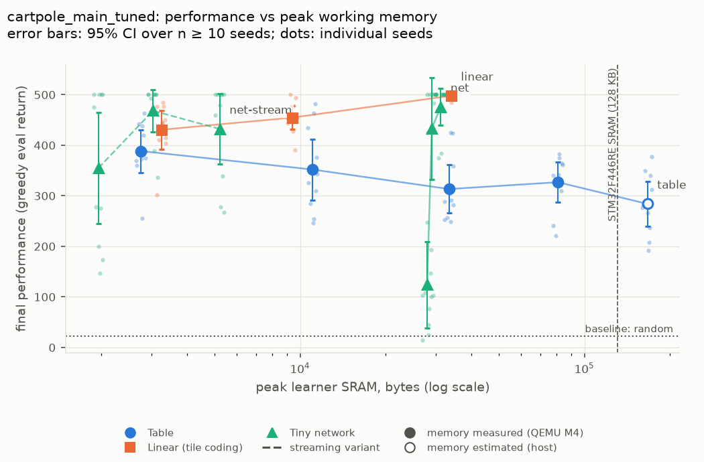

# Results log

Rule: an entry exists only if it was measured, with ≥ 5 seeds where learning
is involved, and it records **date, git commit, config file, exact command, n**.
Single-seed observations from the build are in `build_notes.md`, not here.

| date | stage | claim | numbers (mean ± 95% CI, n) | commit | command / config | figure |
|------|-------|-------|----------------------------|--------|------------------|--------|
| 17 Nov 2026 | 1 | C tabular learner reproduces the Python Q16.16 reference bit for bit on the corridor | 15/15 seed×ε cases identical | 0e0a247 | `make test` | — |
| 17 Nov 2026 | 2 | Pendulum, table learner: final greedy return improves monotonically with table resolution, and memory grows with bins² | 5 bins (1,008 B): −948 ± 47 · 7 (1,296 B): −933 ± 82 · 11 (2,160 B): −770 ± 41 · 15 (3,408 B): −582 ± 70 · 21 (6,000 B): −345 ± 63 · 31 (12,240 B): −245 ± 70 · random −1,147 ± 20 · zero torque −1,068; n = 10 seeds, t 95%, 300k steps, α tuned (0.45, K = 20) | ff8d592 (learner code; runs by Claude in the cloud workspace) | `bash scripts/run_experiment.sh stage2_pendulum_table` | `results/figures/stage2_pendulum_table_tuned_*.png` |
| 17 Nov 2026 | 2 | Table learner cost on the Cortex-M4 (QEMU) is flat in table size | 523–535 instructions per act + learn step; peak SRAM as above; host == M4 bit-exact for all 6 configs | ff8d592 | same | `_compute.png` |
| 17 Nov 2026 | M4 | Learning on the emulated chip (processor-in-the-loop) reproduces host learning bit for bit | 4/4 learners (table, linear, compressed-replay net, stream net), 2,000 pendulum steps each | 1e15897 | `python3 scripts/pil_check.py` | `results/m4/pil_check.json` |

Notes on the Stage 2 entry: no table configuration reached the usual "solved" level (≈ −150) within
300k steps; the largest table was still improving (see the curves). The tuning budget (100k steps) is
shorter than the table needs (D29; from 22 Nov tuning uses the full budget, D49).

## Stage 3: pendulum, all learners, both input encodings (18 Nov 2026, written up 22 Nov)

A first pass with 5 seeds (17 Nov, `c3888b4`, archived at `4efe16f`) came before this 10-seed run; finding 1 compares them.

**Provenance.** Results committed in `c3f4a55` · seeds 0–9, 300,000 environment steps · tuning: K = 20 draws per learner,
seeds 1000–1002, 100,000 steps (`results/tuning/pendulum_main.csv`) · runs
`results/raw_archive/pendulum_main_tuned.tar.gz` · log `results/logs/pendulum_main.log` · library versions were not
recorded with this run · instructions and memory `results/m4/pendulum_main_tuned.csv` (QEMU, synthetic workload;
instruction counts, not timing) · tables by `scripts/results_table.py` and `scripts/compare.py`.

**pendulum_main_tuned** · commit `3e55364` · config `configs/pendulum_main_tuned.json` · command `bash scripts/run_experiment.sh pendulum_main` · seeds per config: 10–10 · intervals: t 95%

| config | final eval return | mean eval (AUC) | online return | peak SRAM (B) | instr./step (M4) | update underflow |
|---|---|---|---|---|---|---|
| table_obs_modeangle_bins5 | -935 ± 70 | -1028 ± 16 | -965 ± 13 | 1008 | 525 | 0.0% |
| table_obs_modeangle_bins7 | -850 ± 72 | -936 ± 19 | -859 ± 10 | 1296 | 525 | 0.0% |
| table_obs_modeangle_bins11 | -669 ± 42 | -828 ± 18 | -765 ± 25 | 2160 | 529 | 0.0% |
| table_obs_modeangle_bins15 | -460 ± 91 | -676 ± 28 | -609 ± 20 | 3408 | 532 | 0.0% |
| table_obs_modeangle_bins21 | -327 ± 95 | -508 ± 21 | -393 ± 19 | 6000 | 534 | 0.0% |
| table_obs_modetrig_bins5 | -854 ± 51 | -951 ± 20 | -866 ± 17 | 2212 | 634 | 0.0% |
| table_obs_modetrig_bins7 | -698 ± 49 | -834 ± 18 | -757 ± 16 | 4828 | 639 | 0.0% |
| table_obs_modetrig_bins11 | -363 ± 87 | -582 ± 33 | -493 ± 19 | 16684 | 641 | 0.0% |
| table_obs_modetrig_bins15 | -250 ± 85 | -486 ± 31 | -360 ± 8 | 41212 | 644 | 0.0% |
| table_obs_modetrig_bins21 | -227 ± 18 | -549 ± 21 | -363 ± 12 | 111844 | 639 | 0.3% |
| linear_obs_modeangle_features64 | -961 ± 94 | -1110 ± 36 | -1135 ± 62 | 1700 | 2280 | 0.0% |
| linear_obs_modeangle_features256 | -224 ± 35 | -458 ± 23 | -364 ± 19 | 4004 | 1814 | 0.2% |
| linear_obs_modeangle_features1024 | -158 ± 35 | -231 ± 10 | -222 ± 5 | 13220 | 1815 | 0.5% |
| linear_obs_modeangle_features4096 | -151 ± 37 | -219 ± 11 | -218 ± 7 | 50084 | 1818 | 0.5% |
| linear_obs_modetrig_features64 | -1157 ± 49 | -1135 ± 24 | -1222 ± 23 | 1744 | 1990 | 0.0% |
| linear_obs_modetrig_features256 | -769 ± 72 | -964 ± 36 | -933 ± 48 | 4048 | 1989 | 0.0% |
| linear_obs_modetrig_features1024 | -143 ± 8 | -321 ± 12 | -251 ± 9 | 13264 | 1990 | 0.5% |
| linear_obs_modetrig_features4096 | -124 ± 5 | -219 ± 13 | -185 ± 3 | 50128 | 2183 | 2.4% |
| net_obs_modeangle_hidden8 | -625 ± 350 | -832 ± 201 | -756 ± 242 | 19356 | 24426 | 1.7% |
| net_obs_modeangle_hidden16 | -574 ± 260 | -578 ± 228 | -531 ± 244 | 19836 | 40088 | 3.4% |
| net_obs_modeangle_hidden32 | -381 ± 109 | -435 ± 78 | -406 ± 76 | 20796 | 71321 | 7.3% |
| net_obs_modeangle_hidden64 | -226 ± 85 | -276 ± 26 | -248 ± 18 | 22716 | 135233 | 12.1% |
| net_obs_modetrig_hidden8 | -868 ± 138 | -881 ± 70 | -835 ± 98 | 23436 | 27262 | 0.9% |
| net_obs_modetrig_hidden16 | -293 ± 77 | -426 ± 50 | -378 ± 28 | 23980 | 44823 | 3.8% |
| net_obs_modetrig_hidden32 | -177 ± 31 | -215 ± 30 | -243 ± 15 | 25068 | 80043 | 7.2% |
| net_obs_modetrig_hidden64 | -133 ± 14 | -178 ± 10 | -200 ± 6 | 27244 | 149541 | 11.3% |
| net-stream_obs_modeangle_hidden8 | -450 ± 237 | -857 ± 103 | -466 ± 124 | 1348 | 10531 | 28.7% |
| net-stream_obs_modeangle_hidden16 | -262 ± 63 | -582 ± 57 | -280 ± 50 | 1828 | 17640 | 37.0% |
| net-stream_obs_modeangle_hidden32 | -172 ± 32 | -412 ± 56 | -213 ± 12 | 2788 | 32082 | 44.6% |
| net-stream_obs_modeangle_hidden64 | -171 ± 45 | -328 ± 24 | -203 ± 5 | 4708 | 61431 | 50.6% |
| net-stream_obs_modetrig_hidden8 | -433 ± 164 | -858 ± 155 | -582 ± 126 | 1416 | 11828 | 24.3% |
| net-stream_obs_modetrig_hidden16 | -202 ± 65 | -485 ± 30 | -327 ± 25 | 1960 | 19785 | 32.2% |
| net-stream_obs_modetrig_hidden32 | -241 ± 115 | -384 ± 36 | -283 ± 23 | 3048 | 36414 | 40.2% |
| net-stream_obs_modetrig_hidden64 | -158 ± 48 | -389 ± 29 | -246 ± 9 | 5224 | 68885 | 50.1% |
| random_obs_modeangle | -1147 ± 20 | -1133 ± 5 | -1233 ± 12 | — | — | — |
| random_obs_modetrig | -1147 ± 20 | -1133 ± 5 | -1233 ± 12 | — | — | — |
| zero-torque_obs_modeangle | -1068 ± 0 | -1068 ± 0 | -1229 ± 11 | — | — | — |
| zero-torque_obs_modetrig | -1068 ± 0 | -1068 ± 0 | -1229 ± 11 | — | — | — |

**Metrics.** Final = mean of the last 3 evaluations (10 episodes each). AUC = mean evaluation return over training
(30 evaluations; higher = learned sooner). Online = mean training return over the last 20% of episodes.

**Reproducibility.** The 190 runs shared with the first pass (cloud) are byte-identical to this laptop run, episode
and evaluation files alike. That shows determinism on x86-64 Linux, not correctness; ARM and macOS are untested.

**Paired differences.** This experiment was not pre-registered: both comparisons were chosen after seeing the
results, and stay at 10 seeds (D50).

| A − B | metric | status | pairs | mean | 95% CI | verdict |
|---|---|---|---|---|---|---|
| net_obs_modetrig_hidden64 − linear_obs_modetrig_features4096 | final | not pre-registered | 10 | -8.73 | [-25.28, +7.82] | inconclusive |
| net_obs_modetrig_hidden64 − linear_obs_modetrig_features4096 | auc | not pre-registered | 10 | +40.9 | [+20.6, +61.2] | A higher |
| net-stream_obs_modeangle_hidden32 − linear_obs_modeangle_features256 | final | not pre-registered | 10 | +51.4 | [-2.9, +105.8] | inconclusive |
| net-stream_obs_modeangle_hidden32 − linear_obs_modeangle_features256 | auc | not pre-registered | 10 | +45.4 | [-7.9, +98.8] | inconclusive |

**Findings** (one task, equal tuning budget).

1. The first pass held for final and online return: all 38 ten-seed means lie inside their 5-seed intervals. For AUC
   37 of 38 do; the exception is linear, angle, 256 features (moved by −20.0, 5-seed half-width 17.9).
2. The replay network (cos/sin, 64 hidden, 27.2 KB) and linear tile coding (cos/sin, 4,096 features, 50.1 KB) are
   inconclusive on final return. The network learns faster, at 68.5x the instructions per step as measured.
3. The streaming network (angle, 32 hidden, 2.8 KB) and linear tile coding (angle, 256 features, 4.0 KB) are
   inconclusive on final return and on AUC. The streaming network costs 17.7x the instructions per step.
4. Descriptive: every point on the mean final-return frontier above 1,296 B and up to 5.2 KB is a streaming
   network. From 13.3 KB the frontier is linear tile coding and the replay network. The table is on it only at
   1,008 B and 1,296 B.
5. Descriptive: streaming networks with 32–64 hidden units have mean AUC −328 to −412; with 8–16 hidden units −485 to
   −858. Networks with 8 hidden units vary widely between seeds (see the dots).
6. The input encoding is a real factor (D01): with cos/sin the 21-bin table costs 111.8 KB instead of 6.0 KB, and
   linear coding with 256 features has a mean final return of −769 instead of −224.
7. Update underflow: table ≤ 0.4%, linear ≤ 2.4%, replay network 0.9–12.1%, streaming network 24–51% (stochastic
   rounding on).

**Limits.**

- Tuning used a third of the step budget, which favours fast starters, and only the angle encoding (D49).
- The linear learner's instructions per step are path dependent (one or two hashes per step, see Stage 5): its
  configurations read 1,814–2,280 although the table size does not matter, so ratios against it carry that uncertainty.
- The committed counts for the 8 streaming networks are 1 instruction per step higher than current code, which has
  the undefined-behaviour fix `6e8904b`. Learned values are identical.

## Stage 4: replay ratio on the pendulum, table arm (22 Nov 2026)

5 replay updates per step did not measurably speed up learning (AUC difference +25, 95% CI [-22, +72], 10 paired seeds) at 2.7x the instructions per step.

**Provenance.** Commit `c32e1fc` (same tree as `d440a56`) · config `configs/replay_ratio.json` · command
`python3 scripts/run_sweep.py replay_ratio --jobs 6 --only table` · seeds 0–9 · mujoco 4.0.1, numpy 2.5.5, pandas 3.1.1 ·
run 22 Nov 2026, 17:14–17:15 CET · instructions and memory from `results/m4/replay_ratio.csv` (QEMU, synthetic
workload; instruction counts, not timing) · runs `results/raw_archive/replay_ratio.tar.gz` · log
`results/logs/replay_ratio_gate.log` · versions `results/logs/replay_ratio.versions`.

**What is compared.** n = 5 against n = 1 replay updates per environment step, **both learning from the same
1,000-transition compressed buffer**. This is not replay against the plain table. n = 1 is not online Q-learning
either: its one update uses a transition drawn uniformly from the stored ones whose successor is known, so never
the transition just observed. The table (11 bins per dimension, cos/sin input) and α = 0.300 are the same in every
arm. α was tuned without replay, on the angle input (D51). All three arms peak at 27,720 B of SRAM, buffer included.

**Criterion.** Pre-registered in D53 (`0fd1c9f`, 22 Nov 16:17 CET, before the run): the paired 95% t interval of
n = 5 − n = 1 on AUC must lie above 0. It does not, so Stage 4 stops and the linear and network arms were not run, nor the references
(random, zero-torque, table-stream, net-stream).
D53 replaced the criterion of 17 Nov (steps-to-threshold), which is reported below as a secondary check.
D53 was written after the no-replay pendulum results were seen, before any replay-ratio run.
The original metric gives the same decision (inconclusive).

**Metrics.** AUC = mean greedy evaluation return over training (30 evaluations in 300k steps; higher = learned
sooner). Final = mean of the last 3 evaluations. Steps-to-threshold = first evaluation at or above −200.

**replay_ratio** · commit `c32e1fc` · config `configs/replay_ratio.json` · command `python3 scripts/run_sweep.py replay_ratio --jobs 6 --only table` · seeds per config: 10–10 · intervals: t 95%

| config | final eval return | mean eval (AUC) | online return | peak SRAM (B) | instr./step (M4) | update underflow | flash, bench firmware with all three learners (B) | update saturation |
|---|---|---|---|---|---|---|---|---|
| table_batch1 | -348 ± 62 | -618 ± 34 | -504 ± 23 | 27720 | 1207 | 0.0% | 15528 | 0% |
| table_batch5 | -389 ± 81 | -593 ± 36 | -540 ± 19 | 27720 | 3306 | 0.0% | 15528 | 0% |
| table_batch20 | -434 ± 63 | -650 ± 27 | -606 ± 16 | 27720 | 11210 | 0.2% | 15528 | 0% |

| difference (paired, 10 seeds) | status | mean | 95% CI | verdict |
|---|---|---|---|---|
| AUC, n = 5 − n = 1 | pre-registered gate | +24.6 | [-22.4, +71.5] | inconclusive; gate not met |
| AUC, n = 20 − n = 1 | exploratory | -32.6 | [-83.3, +18.0] | inconclusive |
| final, n = 5 − n = 1 | exploratory, not pre-registered | -41.3 | [-137.5, +54.9] | inconclusive |
| final, n = 20 − n = 1 | exploratory, not pre-registered | -86.6 | [-183.4, +10.3] | inconclusive |

| updates per step | instructions per step | seeds that reached −200 |
|---|---|---|
| 1 | 1206.6 | 9/10 |
| 5 | 3306.3 | 10/10 |
| 20 | 11210.3 | 7/10 |

**Original criterion (secondary).** Steps-to-threshold, n = 1 vs n = 5:
9/10 vs 10/10 seeds reached -200; the direction depends on how the missing seed is counted, so inconclusive.

**Reproducibility.** The table arm was run once and has not been repeated. Every run's metadata records the commit
and the full configuration.

**Limits.** One task, one table size, one buffer size, untuned per replay ratio. The interval reaches +72, so a
useful speed-up from 5 updates is not ruled out.

## Stage 5: cart-pole, all learners (22 Nov 2026)

**Provenance.** Run at `d78ae38` · seeds 0–9, 200,000 environment steps · tuning: K = 20 draws per learner, seeds
1000–1002, at the full budget (D49), `results/tuning/cartpole_main.csv` · runs
`results/raw_archive/cartpole_main_tuned.tar.gz` · log `results/logs/cartpole_main.log` · versions
`results/logs/cartpole_main.versions` · instructions and memory `results/m4/cartpole_main_tuned.csv` (QEMU, synthetic
workload; instruction counts, not timing) · tables by `scripts/results_table.py` and `scripts/compare.py`.

**cartpole_main_tuned** · commit `d78ae38` · config `configs/cartpole_main_tuned.json` · command `bash scripts/run_experiment.sh cartpole_main` · seeds per config: 10–10 · intervals: t 95%

| config | final eval return | mean eval (AUC) | online return | peak SRAM (B) | instr./step (M4) | update underflow | flash, bench firmware with all three learners (B) | update saturation |
|---|---|---|---|---|---|---|---|---|
| table_bins4 | 388 ± 42 | 282 ± 19 | 228 ± 8 | 2760 | 708 | 0.0% | 15532 | 0% |
| table_bins6 | 352 ± 61 | 285 ± 21 | 230 ± 15 | 11080 | 715 | 0.0% | 15532 | 0% |
| table_bins8 | 313 ± 48 | 266 ± 21 | 208 ± 13 | 33480 | 709 | 0.0% | 15532 | 0% |
| table_bins10 | 327 ± 40 | 260 ± 15 | 212 ± 8 | 80712 | 711 | 0.0% | 15536 | 0% |
| table_bins12 | 284 ± 44 | 233 ± 15 | 193 ± 7 | 166132 (est.), does not fit | — | 0.0% | — | 0% |
| linear_features256 | 431 ± 39 | 275 ± 16 | 228 ± 9 | 3256 | 4155 | 0.4% | 15532 | 0% |
| linear_features1024 | 455 ± 23 | 346 ± 17 | 248 ± 6 | 9400 | 3046 | 0.2% | 15532 | 0% |
| linear_features4096 | 498 ± 4 | 440 ± 10 | 262 ± 3 | 33976 | 3047 | 0.2% | 15532 | 0% |
| net_hidden16 | 124 ± 85 | 120 ± 47 | 73.6 ± 41.8 | 27984 | 47571 | 13.4% | 15532 | 0% |
| net_hidden32 | 433 ± 100 | 232 ± 34 | 143 ± 23 | 29072 | 84724 | 28.0% | 15532 | 0% |
| net_hidden64 | 476 ± 36 | 265 ± 24 | 157 ± 18 | 31248 | 159046 | 31.2% | 15532 | 0% |
| net-stream_hidden16 | 355 ± 110 | 359 ± 46 | 274 ± 57 | 1952 | 20500 | 31.1% | 15532 | 0% |
| net-stream_hidden32 | 468 ± 41 | 410 ± 29 | 327 ± 20 | 3040 | 37331 | 44.9% | 15532 | 0% |
| net-stream_hidden64 | 432 ± 70 | 387 ± 45 | 303 ± 40 | 5216 | 71974 | 47.2% | 15532 | 0% |
| random | 21.9 ± 1.6 | 21.4 ± 0.6 | 21.4 ± 0.1 | — | — | — | — | — |

**Metrics.** Return = steps balanced, at most 500. Final = mean of the last 3 evaluations (10 episodes each). AUC = mean
evaluation return over training (20 evaluations; higher = learned sooner). Online = mean training return over the
last 20% of episodes.

**Reproducibility.** Every run's metadata records the commit and the full configuration, and all 150 runs match the
committed tuned config. The runs are deterministic on x86-64 Linux; this experiment was run once.

**Pre-registered differences** (D49 table; paired by seed, Student-t 95%).

| A − B | metric | status | pairs | mean | 95% CI | verdict |
|---|---|---|---|---|---|---|
| linear_features1024 − table_bins8 | final | pre-registered | 10 | +141.3 | [+96.9, +185.7] | A higher |
| linear_features1024 − table_bins8 | auc | pre-registered | 10 | +80.4 | [+53.0, +107.8] | A higher |
| net_hidden32 − linear_features1024 | final | pre-registered | 10 | -21.3 | [-128.6, +86.0] | inconclusive |
| net_hidden32 − linear_features1024 | auc | pre-registered | 10 | -114.4 | [-160.9, -67.9] | A lower |
| net-stream_hidden32 − linear_features1024 | final | pre-registered | 10 | +13.5 | [-37.2, +64.3] | inconclusive |
| net-stream_hidden32 − linear_features1024 | auc | pre-registered | 10 | +63.6 | [+26.0, +101.1] | A higher |

**Findings.**

1. Linear tile coding (1,024 features, 9.4 KB) beats the table (8 bins, 33.5 KB) on final return and on AUC, at 4.3x
   the table's instructions per step.
2. The streaming network (32 hidden, 3.0 KB) learns faster than linear tile coding (1,024 features, 9.4 KB) in a third
   of the memory, at 12x the instructions per step. The difference in final return is inconclusive.
3. The replay network (32 hidden, 29.1 KB) learns more slowly than linear tile coding (1,024 features), at 28x the
   instructions per step. The difference in final return is inconclusive.
4. Descriptive, not tested: more memory did not raise the table's mean final return (388 at 2.8 KB, 284 at 12 bins).
   The 12-bin table does not fit in the 128 KB of SRAM; its return comes from the host run only.

**Limits.**

- One task, equal tuning budget, one tuning point per learner. The table's selected α (0.067) is the smallest of its
  20 draws, the replay network's target period (500) and the streaming network's κ and λ (1.5, 0.6) are on the edge of
  their search grids. The streaming network's 20 draws covered only 9 distinct settings.
- The 500-step cap compresses differences between learners that solve the task.
- The linear learner's instructions per step depend on the path the benchmark takes: its two-slot feature cache makes
  it hash once or twice per step. In the measured window the 256-feature learner hashed 1.72 times per step (4,155
  instructions) and the two larger ones once (3,046–3,047). The table size is not the cause, and ratios against the
  linear learner are uncertain by about that much.
- Update underflow is high for both networks (13–47% of update products round to zero).
